# Untranslatability beyond single words: distortion against length

Generated by `python -m sent.report` from `results/sent/<model>/*.json`. Design: `../HANDOFF_sentence_untranslatability.md`.

**How to read every number here.** Each is measured *inside one model*, and both meaning spaces come from English-leaning models: that is a limitation and also part of the question. D_s(L) is the lower envelope over a finite set of candidates, so it is an upper bound: better translations at a given length may exist. Practices on the ladder: B0 word-for-word, B1 standard translation, B2 keep the word, B3 inline gloss, B4 alternatives, B5 footnote, B6 thick translation, B7 coinage.

## meta-llama/Llama-3.1-8B-Instruct (nf4)

Validation raised no stop flags.

### Validation (§6)

- **Layer for d_CL:** 7 (neighbours [6, 8]), tau = 3.16228; AUROC matched vs mismatched controls 0.999 (95% CI 1.00-1.00). Layers where the spelling control won: [1, 2, 3, 28, 29, 30, 31, 32].
- **Tolerance epsilon** (90th percentile of d(control, B1)): round trip 0.140, concept layer 0.178.
- **Ladder (round trip):** best B6 minus best B1 = -0.182 (-0.231 to -0.138); passed. Spearman of rung length vs mean best d: -0.60.
- **Heat map (round trip):** AUROC of word leftover, annotated hot words vs other content words: 0.726 (CI 0.64-0.81; 67 hot, 56 other).
- **Ladder (concept layer):** best B6 minus best B1 = -0.045 (-0.054 to -0.036); passed. Spearman of rung length vs mean best d: -0.48.
- **Heat map (concept layer):** AUROC of word leftover, annotated hot words vs other content words: 0.697 (CI 0.60-0.79; 67 hot, 56 other).
- **Me gusta mucho el duende (rt):** leftover duende 0.50, gusta 0.23, mucho 0.01 (n/a = the word carries no information weight); expected order duende > gusta > mucho holds.
- **Me gusta mucho el duende (cl):** leftover duende 0.21, gusta 0.14, mucho 0.14 (n/a = the word carries no information weight); expected order duende > gusta > mucho holds.
- **Agreement of the two spaces:** Spearman across sentences, A 0.51 (n=40), U 0.16; per-token leftover on B1 0.41 (n=335).
- **Second back-translator meta-llama/Llama-3.2-3B-Instruct (bf16):** Spearman of A with the main round trip 0.75 (n=40).
- **Second back-translator CohereForAI/aya-23-8B (nf4):** Spearman of A with the main round trip 0.70 (n=40).
- **Second back-translator Qwen/Qwen2.5-7B-Instruct (nf4):** Spearman of A with the main round trip 0.71 (n=40).

### English detour (§6.5)

d_CL of the greedy standard translation at the concept layer vs the detour layers [21, 22, 23, 24, 25] (negative = the English looks closer in the detour layers).

| category | n | concept layer | detour | detour - concept (95% CI) |
|---|---|---|---|---|
| untranslatable_in_context | 12 | 0.179 | 0.158 | -0.021 (-0.027 to -0.015) |
| construction | 8 | 0.172 | 0.153 | -0.019 (-0.027 to -0.010) |
| idiom | 8 | 0.179 | 0.157 | -0.022 (-0.032 to -0.012) |
| dialect | 2 | 0.217 | 0.174 | -0.043 (-0.048 to -0.038) |
| control | 10 | 0.140 | 0.131 | -0.009 (-0.015 to -0.003) |

### Spelling / copying check (§2.1, §2.2)

| space | gain of B2 (keep the word) | B2 gain with source words masked | share surviving | gain of B3 (gloss) |
|---|---|---|---|---|
| rt | 0.105 | -0.053 | -0.51 | 0.041 |
| cl | 0.020 | -0.001 | -0.04 | 0.004 |

### Untranslatability by category

U = doublings of length beyond the standard translation before d <= epsilon (censored = never reached; the bound is used). A = mean distortion over log-spaced lengths from L0 to L0 x 2^4.25.

| category | n | U round trip | censored | U concept | censored | A round trip | A concept |
|---|---|---|---|---|---|---|---|
| untranslatable_in_context | 12 | 0.93 | 0/12 | 0.25 | 0/12 | 0.089 | 0.140 |
| construction | 8 | 1.09 | 0/8 | 0.24 | 0/8 | 0.079 | 0.132 |
| idiom | 8 | 0.86 | 1/8 | 0.27 | 0/8 | 0.067 | 0.126 |
| dialect | 2 | 2.10 | 0/2 | 0.74 | 0/2 | 0.272 | 0.148 |
| control | 10 | 0.21 | 0/10 | 0.38 | 0/10 | 0.023 | 0.129 |

### Per sentence

| sentence | category | standard translation | U rt | U cl | hot spans: U rt (construction gap) |
|---|---|---|---|---|---|
| *Me gusta mucho el duende.* | untranslatable_in_context | I really like the elf. | 0.22 | 0.00 | *duende* 0.22; *gusta* 0.22 |
| *Sinto muita saudade da casa da minha avó.* | untranslatable_in_context | I miss my grandmother's house a lot. | 3.95 | 0.15 | *saudade* 0.00 |
| *Nos quedamos de sobremesa hasta que anocheció.* | untranslatable_in_context | We stayed for dessert until it got dark. | 3.75 | 0.15 | *de sobremesa* 3.75 (gap -0.30) |
| *Jeden Herbst packt mich das Fernweh.* | untranslatable_in_context | Every autumn, homesickness for distant places gets me. | 0.00 | 1.49 | *Fernweh* 0.00; *packt mich* 0.00 (gap +0.00) |
| *Porta quel vestito con una certa sprezzatura.* | untranslatable_in_context | Wear that dress with a certain nonchalance. | 0.00 | 0.00 | *sprezzatura* 0.00 |
| *Magari passo da te stasera, vediamo.* | untranslatable_in_context | Maybe I'll drop by your place tonight, shall we see. | 0.00 | 1.21 | *Magari* 1.21 |
| *Ele deu um jeitinho e conseguiu o documento no mesmo dia.* | untranslatable_in_context | He managed to get the document the same day by doing a favor. | 0.28 | 0.00 | *deu um jeitinho* 0.28 (gap +0.00) |
| *Ela fazia cafuné no filho até ele dormir.* | untranslatable_in_context | She used to tickle her child until he fell asleep. | 0.00 | 0.00 | *fazia cafuné* 0.00 (gap -1.91) |
| *In der kleinen Hütte herrschte eine wunderbare Gemütlichkeit.* | untranslatable_in_context | There was a wonderful sense of coziness in the small cottage. | 0.00 | 0.00 | *Gemütlichkeit* 0.00 |
| *Endlich Feierabend, gehen wir noch ein Bier trinken?* | untranslatable_in_context | Finally it's time to knock off work, shall we go grab a beer? | 2.92 | 0.00 | *Feierabend* 0.00 |
| *À Tokyo, j'ai ressenti un profond dépaysement.* | untranslatable_in_context | In Tokyo, I felt a deep sense of disorientation. | 0.00 | 0.00 | *dépaysement* 0.00 |
| *Les retrouvailles avec mes cousins ont été très émouvantes.* | untranslatable_in_context | Reuniting with my cousins was very emotional. | 0.00 | 0.00 | *retrouvailles* 0.00 |
| *A mi hermana le gustan las películas de terror.* | construction | My sister likes horror movies. | 0.87 | 0.00 | *le gustan* 0.00 |
| *Mi manchi tanto, lo sai?* | construction | You're really missing me, don't you? | 0.00 | 0.00 | *Mi manchi* 0.00 |
| *Se me olvidó el paraguas en el tren.* | construction | I forgot my umbrella on the train. | 0.00 | 0.17 | *Se me olvidó* 0.00 (gap -0.46) |
| *Mir ist kalt, kannst du das Fenster zumachen?* | construction | I'm cold, can you close the window? | 2.10 | 0.00 | *Mir ist kalt* 2.10 |
| *La película es aburrida, y yo estoy aburrido.* | construction | The movie is boring, and I'm bored too. | 0.00 | 0.00 | *es aburrida* 0.00 (gap +0.00); *estoy aburrido* 0.00 (gap +0.00) |
| *Il me faut encore une heure pour finir.* | construction | I still need another hour to finish. | 0.00 | 0.00 | *Il me faut* 0.00 |
| *Comprei o livro para lermos juntos.* | construction | I bought the book so we could read it together. | 4.00 | 0.00 | *lermos* 4.00 |
| *Magari fosse già venerdì!* | construction | How wonderful if it were already Friday! | 1.75 | 1.75 | *Magari fosse* 1.75 (gap +0.00) |
| *No te creo, me estás tomando el pelo.* | idiom | I don't believe you, you're pulling my leg. | 0.00 | 0.22 | *me estás tomando el pelo* 0.22 |
| *Domani hai l'esame? In bocca al lupo!* | idiom | Will you have an exam tomorrow? Good luck! | 0.00 | 1.38 | *In bocca al lupo* 0.14 |
| *Depuis qu'il pleut, j'ai le cafard.* | idiom | Since it's been raining, I'm feeling down. | 1.67 | 0.00 | *j'ai le cafard* 0.00 (gap +0.00) |
| *Hast du Tomaten auf den Augen? Die Ampel ist rot!* | idiom | Are you looking at the tomatoes? The traffic light is red! | 0.00 | 0.11 | *Tomaten auf den Augen* 0.00 (gap -0.11) |
| *Estou com saudades de você.* | idiom | I'm missing you. | >4.98 | 0.49 | *Estou com saudades* >4.98 (gap +0.32) |
| *Mi hijo siempre está en las nubes en clase.* | idiom | My son is always daydreaming in class. | 0.00 | 0.00 | *está en las nubes* 0.00 (gap +0.00) |
| *La nuova collega è proprio in gamba.* | idiom | The new colleague is really something. | 0.19 | 0.00 | *in gamba* 0.36 (gap +0.00) |
| *Elle m'a posé un lapin hier soir.* | idiom | She put a rabbit on me last night. | 0.00 | 0.00 | *m'a posé un lapin* 0.00 (gap +0.00) |
| *cominceranno a ddì: ffora a cchi ttoca.* | dialect | They will start saying: "outside it touches." | 2.83 | 0.38 | *ffora a cchi ttoca* 2.83 (gap +0.00) |
| *de schertri da la terra a ppecorone,* | dialect | From the fields to the countryside. | 1.36 | 1.10 | *schertri* 2.95; *a ppecorone* 1.10 (gap +0.00) |
| *El tren sale a las ocho de la mañana.* | control | The train leaves at eight in the morning. | 0.00 | 0.00 |  |
| *Mi hermana vive en una casa pequeña.* | control | My sister lives in a small house. | 0.00 | 0.00 |  |
| *Ich habe zwei Brüder und eine Schwester.* | control | I have two brothers and a sister. | 0.00 | 0.00 |  |
| *Das Buch liegt auf dem Tisch in der Küche.* | control | The book is on the table in the kitchen. | 0.00 | 0.00 |  |
| *Il negozio chiude alle sette di sera.* | control | The store closes at seven in the evening. | 0.00 | 3.80 |  |
| *Mio padre beve un caffè ogni mattina.* | control | My father drinks a coffee every morning. | 2.09 | 0.00 |  |
| *O médico chegou ao hospital às nove horas.* | control | The doctor arrived at the hospital at nine o'clock. | 0.00 | 0.00 |  |
| *Comprei pão e leite no mercado.* | control | I bought bread and milk at the market. | 0.00 | 0.00 |  |
| *Le chat dort sur le canapé rouge.* | control | The cat is sleeping on the red sofa. | 0.00 | 0.00 |  |
| *Nous avons visité le musée avec nos enfants.* | control | We visited the museum with our children. | 0.00 | 0.00 |  |

### Spread over standard translations (§1)

20 standard translations at T=1.0; H in bits over NLI meaning clusters.

| sentence | span | kind | H | clusters | usable | top renderings |
|---|---|---|---|---|---|---|
| es_duende | *duende* | hot | 3.32 | 12 | 19/20 | elf 26%, dwarf 11%, troll 11% |
| es_duende | *gusta* | hot | 0.99 | 3 | 18/20 | like 78%, love 11%, enjoy 11% |
| pt_saudade | *saudade* | hot | 2.24 | 6 | 20/20 | i really miss 40%, i 25%, miss 10% |
| es_sobremesa | *de sobremesa* | hot | 3.25 | 11 | 20/20 | on for dessert 20%, at the table 15%, for dessert 15% |
| de_fernweh | *Fernweh* | hot | 1.18 | 3 | 20/20 | homesickness for distant places 70%, wanderlust 15%, homesickness 15% |
| de_fernweh | *packt mich* | hot | 1.88 | 7 | 19/20 | hits me 63%, wanderlust gets the better of me 11%, get 5% |
| it_sprezzatura | *sprezzatura* | hot | 0.75 | 3 | 20/20 | nonchalance 85%, air of nonchalance 10%, carefree nonchalance 5% |
| it_magari_forse | *Magari* | hot | 0.88 | 3 | 20/20 | maybe 80%, we might 15%, we'll see, maybe 5% |
| pt_jeitinho | *deu um jeitinho* | hot | 3.10 | 11 | 20/20 | by doing a favor 25%, with a bit of effort 20%, he managed to get the document somehow 15% |
| pt_cafune | *fazia cafuné* | hot | 2.60 | 9 | 20/20 | she tickled 45%, she would rock 10%, rock 10% |
| de_gemuetlichkeit | *Gemütlichkeit* | hot | 1.74 | 5 | 20/20 | coziness 55%, warm and cozy atmosphere 25%, warm and wonderful coziness 10% |
| de_feierabend | *Feierabend* | hot | 1.97 | 7 | 20/20 | quitting time 60%, finally it's the end of work 10%, time to unwind 10% |
| fr_depaysement | *dépaysement* | hot | 0.81 | 2 | 20/20 | culture shock 75%, disorientation 25% |
| fr_retrouvailles | *retrouvailles* | hot | 0.00 | 1 | 19/20 | the reunions 100% |
| es_gustar | *le gustan* | hot | 0.97 | 2 | 20/20 | likes 60%, enjoys 40% |
| it_mi_manchi | *Mi manchi* | hot | 1.91 | 5 | 20/20 | you're 45%, you 25%, i miss you 20% |
| es_se_me_olvido | *Se me olvidó* | hot | 0.47 | 2 | 20/20 | i forgot 90%, i left 10% |
| de_mir_ist_kalt | *Mir ist kalt* | hot | 0.00 | 1 | 20/20 | i'm cold 100% |
| es_ser_estar | *es aburrida* | hot | 1.00 | 2 | 20/20 | the movie 50%, the movie is boring 50% |
| es_ser_estar | *estoy aburrido* | hot | 1.23 | 3 | 20/20 | so am i 50%, i'm 45%, i'm bored myself 5% |
| fr_il_me_faut | *Il me faut* | hot | 0.88 | 2 | 20/20 | i still need another 70%, i still have another hour to finish 30% |
| pt_infinitivo_pessoal | *lermos* | hot | 0.72 | 2 | 20/20 | i bought the book for us to read together 80%, so we can 20% |
| it_magari_wish | *Magari fosse* | hot | 1.70 | 5 | 20/20 | i wish 45%, how wonderful 40%, how wonderful it would be if it were already friday 5% |
| es_tomar_el_pelo | *me estás tomando el pelo* | hot | 1.02 | 4 | 20/20 | you're pulling 80%, you're taking 10%, come on, you're pulling 5% |
| it_in_bocca_al_lupo | *In bocca al lupo* | hot | 0.29 | 2 | 20/20 | good luck 95%, good luck with it 5% |
| fr_cafard | *j'ai le cafard* | hot | 0.95 | 2 | 19/20 | since it's been raining, i'm feeling glum 63%, i've been feeling down 37% |
| de_tomaten | *Tomaten auf den Augen* | hot | 2.33 | 7 | 20/20 | are you looking at tomatoes 35%, are you looking at the tomatoes with your eyes 30%, do you have tomatoes on your eyes 15% |
| pt_estou_com_saudades | *Estou com saudades* | hot | 1.81 | 4 | 20/20 | i'm 45%, i'm feeling 25%, i miss you 20% |
| es_en_las_nubes | *está en las nubes* | hot | 1.43 | 3 | 19/20 | daydreaming 53%, is always in the clouds 32%, spaced out 16% |
| it_in_gamba | *in gamba* | hot | 2.18 | 6 | 20/20 | first-rate 35%, something 25%, really talented 25% |
| fr_poser_un_lapin | *m'a posé un lapin* | hot | 3.52 | 12 | 14/20 | pulled a rabbit 14%, made a fool of 14%, she sneaked up on me and gave me a scare 7% |
| es_tren | *tren* | probe | 0.00 | 1 | 20/20 | the train 100% |
| es_casa | *casa* | probe | 0.00 | 1 | 20/20 | house 100% |
| de_brueder | *Brüder* | probe | 0.00 | 1 | 20/20 | brothers 100% |
| de_tisch | *Tisch* | probe | 0.00 | 1 | 20/20 | table 100% |
| it_negozio | *negozio* | probe | n/a | 1 | 4/20 | the store 100% |
| it_caffe | *caffè* | probe | 0.00 | 1 | 20/20 | coffee 100% |
| pt_medico | *médico* | probe | n/a | 0 | 0/20 |  |
| pt_mercado | *leite* | probe | 0.00 | 1 | 20/20 | milk 100% |
| fr_chat | *canapé* | probe | 0.47 | 2 | 20/20 | sofa 90%, couch 10% |
| fr_musee | *enfants* | probe | 0.00 | 1 | 20/20 | children 100% |
| rom_ffora | *ffora a cchi ttoca* | hot | 3.15 | 11 | 16/20 | outside it touches 31%, they will begin to say: outside it touches 12%, far away, touch 6% |
| rom_schertri | *schertri* | hot | 3.82 | 16 | 20/20 | scraps 20%, from 10%, old men 5% |
| rom_schertri | *a ppecorone* | hot | 4.06 | 17 | 18/20 | to the sheep 11%, to pescarone 6%, garlic shoots 6% |

Mean H: hot spans 1.71 bits (n=34), control probe words 0.06 bits (n=8).

### Targeting test (§3)

Glosses chosen by the rt heat map. Cut = distortion of the standard translation minus distortion after the glosses (positive = the glosses helped).

| space | cut, targeted | cut, random | targeted - random (95% CI) | sentences where targeted won |
|---|---|---|---|---|
| rt | +0.021 (+0.006 to +0.038) | +0.018 (+0.008 to +0.031) | +0.003 (-0.008 to +0.015) | 50% |
| cl | +0.004 (+0.003 to +0.005) | +0.003 (+0.002 to +0.004) | +0.001 (-0.000 to +0.002) | 62% |

Tokens added: targeted 12.1, random 8.8.

### Figures

**In 'me gusta mucho el duende', the most meaning is lost on 'duende'**  
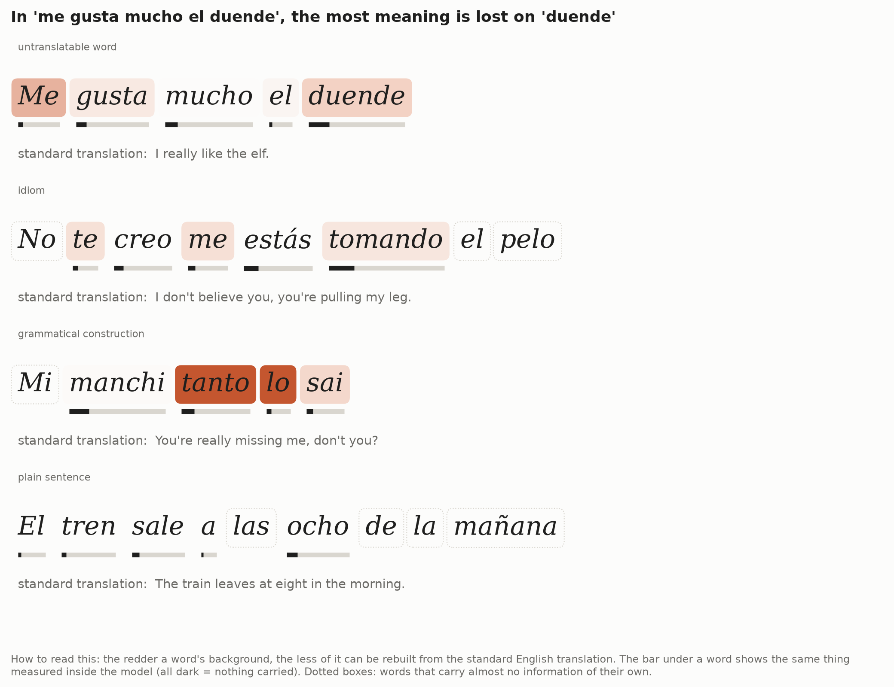  
How to read this: the redder a word's background, the less of it can be rebuilt from the standard English translation. The bar under a word shows the same thing measured inside the model (all dark = nothing carried). Dotted boxes: words that carry almost no information of their own.

**How much English it takes before the meaning gets across**  
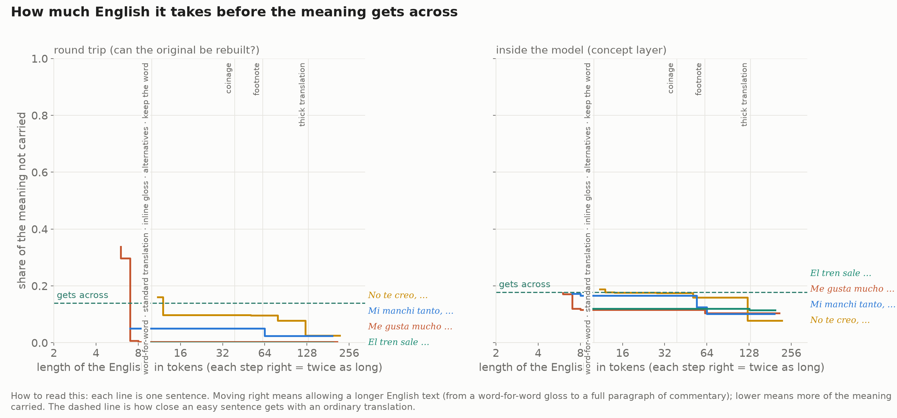  
How to read this: each line is one sentence. Moving right means allowing a longer English text (from a word-for-word gloss to a full paragraph of commentary); lower means more of the meaning carried. The dashed line is how close an easy sentence gets with an ordinary translation.

**Opening up a sentence instead of substituting word for word**  
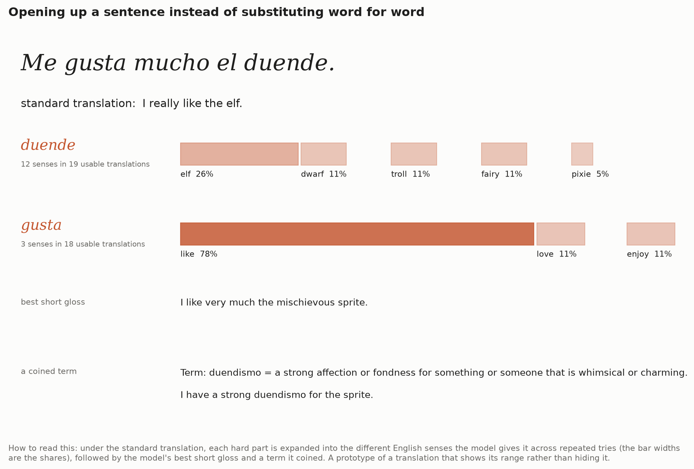  
How to read this: under the standard translation, each hard part is expanded into the different English senses the model gives it across repeated tries (the bar widths are the shares), followed by the model's best short gloss and a term it coined. A prototype of a translation that shows its range rather than hiding it.

**Glossing the marked words did not reliably beat glossing random words**  
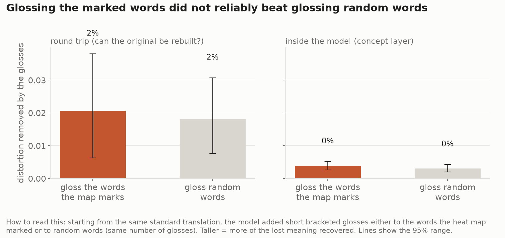  
How to read this: starting from the same standard translation, the model added short bracketed glosses either to the words the heat map marked or to random words (same number of glosses). Taller = more of the lost meaning recovered. Lines show the 95% range.

**Doublings of length needed, average by kind of sentence: plain 0.2, untranslatable word 0.9, construction 1.1, idiom 0.9, dialect 2.1**  
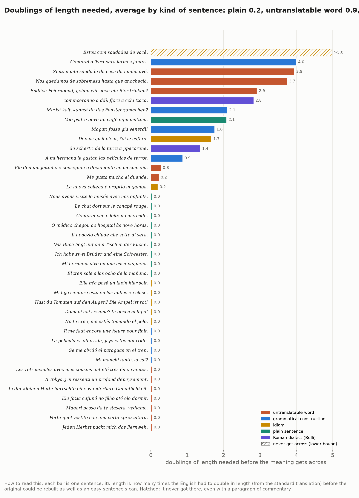  
How to read this: each bar is one sentence; its length is how many times the English had to double in length (from the standard translation) before the original could be rebuilt as well as an easy sentence's can. Hatched: it never got there, even with a paragraph of commentary.

**The two ways of measuring broadly agree (rank correlation 0.51)**  
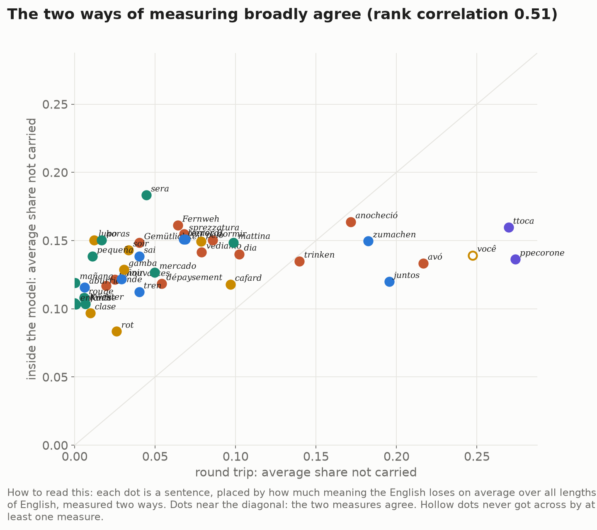  
How to read this: each dot is a sentence, placed by how much meaning the English loses on average over all lengths of English, measured two ways. Dots near the diagonal: the two measures agree. Hollow dots never got across by at least one measure.

## meta-llama/Llama-3.2-3B-Instruct (bf16)

Validation raised no stop flags.

### Validation (§6)

- **Layer for d_CL:** 15 (neighbours [14, 16]), tau = 3.16228; AUROC matched vs mismatched controls 0.996 (95% CI 0.99-1.00). Layers where the spelling control won: [1, 2, 3, 27, 28].
- **Tolerance epsilon** (90th percentile of d(control, B1)): round trip 0.088, concept layer 0.159.
- **Ladder (round trip):** best B6 minus best B1 = -0.183 (-0.242 to -0.128); passed. Spearman of rung length vs mean best d: -0.55.
- **Heat map (round trip):** AUROC of word leftover, annotated hot words vs other content words: 0.653 (CI 0.56-0.75; 67 hot, 57 other).
- **Ladder (concept layer):** best B6 minus best B1 = -0.050 (-0.060 to -0.041); passed. Spearman of rung length vs mean best d: -0.44.
- **Heat map (concept layer):** AUROC of word leftover, annotated hot words vs other content words: 0.661 (CI 0.56-0.75; 67 hot, 57 other).
- **Me gusta mucho el duende (rt):** leftover duende 0.75, gusta 0.13, mucho 0.03 (n/a = the word carries no information weight); expected order duende > gusta > mucho holds.
- **Me gusta mucho el duende (cl):** leftover duende 0.23, gusta 0.11, mucho 0.12 (n/a = the word carries no information weight); expected order duende > gusta > mucho does not hold.
- **Agreement of the two spaces:** Spearman across sentences, A 0.24 (n=40), U 0.41; per-token leftover on B1 0.41 (n=333).
- **Second back-translator meta-llama/Llama-3.1-8B-Instruct (nf4):** Spearman of A with the main round trip 0.74 (n=40).
- **Second back-translator CohereForAI/aya-23-8B (nf4):** Spearman of A with the main round trip 0.63 (n=40).
- **Second back-translator Qwen/Qwen2.5-7B-Instruct (nf4):** Spearman of A with the main round trip 0.73 (n=40).

### English detour (§6.5)

d_CL of the greedy standard translation at the concept layer vs the detour layers [19, 20, 21, 22, 23] (negative = the English looks closer in the detour layers).

| category | n | concept layer | detour | detour - concept (95% CI) |
|---|---|---|---|---|
| untranslatable_in_context | 12 | 0.181 | 0.168 | -0.013 (-0.016 to -0.008) |
| construction | 8 | 0.160 | 0.155 | -0.006 (-0.012 to +0.001) |
| idiom | 8 | 0.175 | 0.169 | -0.006 (-0.015 to +0.002) |
| dialect | 2 | 0.198 | 0.178 | -0.020 (-0.022 to -0.018) |
| control | 10 | 0.134 | 0.132 | -0.002 (-0.005 to +0.002) |

### Spelling / copying check (§2.1, §2.2)

| space | gain of B2 (keep the word) | B2 gain with source words masked | share surviving | gain of B3 (gloss) |
|---|---|---|---|---|
| rt | 0.089 | 0.038 | 0.42 | 0.040 |
| cl | 0.014 | 0.006 | 0.41 | 0.006 |

### Untranslatability by category

U = doublings of length beyond the standard translation before d <= epsilon (censored = never reached; the bound is used). A = mean distortion over log-spaced lengths from L0 to L0 x 2^4.0.

| category | n | U round trip | censored | U concept | censored | A round trip | A concept |
|---|---|---|---|---|---|---|---|
| untranslatable_in_context | 12 | 1.69 | 3/12 | 0.52 | 0/12 | 0.108 | 0.125 |
| construction | 8 | 1.01 | 0/8 | 0.66 | 0/8 | 0.065 | 0.131 |
| idiom | 8 | 0.60 | 1/8 | 1.39 | 1/8 | 0.074 | 0.141 |
| dialect | 2 | 2.47 | 0/2 | 0.86 | 0/2 | 0.298 | 0.125 |
| control | 10 | 0.22 | 0/10 | 0.35 | 0/10 | 0.021 | 0.125 |

### Per sentence

| sentence | category | standard translation | U rt | U cl | hot spans: U rt (construction gap) |
|---|---|---|---|---|---|
| *Me gusta mucho el duende.* | untranslatable_in_context | I really like the elf. | 0.42 | 0.00 | *duende* 0.00; *gusta* 0.00 |
| *Sinto muita saudade da casa da minha avó.* | untranslatable_in_context | I miss my grandmother's house a lot. | 2.42 | 0.42 | *saudade* 0.00 |
| *Nos quedamos de sobremesa hasta que anocheció.* | untranslatable_in_context | We stayed over dessert until it got dark. | 2.53 | 2.53 | *de sobremesa* 2.53 (gap +0.00) |
| *Jeden Herbst packt mich das Fernweh.* | untranslatable_in_context | Every autumn, I'm hit with homesickness. | >3.86 | 2.14 | *Fernweh* 0.00; *packt mich* 0.00 (gap +0.00) |
| *Porta quel vestito con una certa sprezzatura.* | untranslatable_in_context | Wear that outfit with a certain nonchalance. | 0.00 | 0.00 | *sprezzatura* 0.00 |
| *Magari passo da te stasera, vediamo.* | untranslatable_in_context | Maybe you could drop by tonight, let's see. | 0.13 | 0.13 |  |
| *Ele deu um jeitinho e conseguiu o documento no mesmo dia.* | untranslatable_in_context | He managed to get the document on the same day. | >3.70 | 0.24 | *deu um jeitinho* >3.70 (gap +0.00) |
| *Ela fazia cafuné no filho até ele dormir.* | untranslatable_in_context | She was rocking her child to sleep. | >4.09 | 0.81 | *fazia cafuné* >4.09 (gap +0.00) |
| *In der kleinen Hütte herrschte eine wunderbare Gemütlichkeit.* | untranslatable_in_context | There was a wonderful atmosphere in the small cabin. | 0.26 | 0.00 | *Gemütlichkeit* 0.38 |
| *Endlich Feierabend, gehen wir noch ein Bier trinken?* | untranslatable_in_context | Finally, it's five o'clock, shall we still go grab a beer? | 0.00 | 0.00 | *Feierabend* 0.00 |
| *À Tokyo, j'ai ressenti un profond dépaysement.* | untranslatable_in_context | I felt a deep sense of disorientation in Tokyo. | 2.86 | 0.00 | *dépaysement* 2.86 |
| *Les retrouvailles avec mes cousins ont été très émouvantes.* | untranslatable_in_context | The reunion with my cousins was very emotional. | 0.00 | 0.00 | *retrouvailles* 0.00 |
| *A mi hermana le gustan las películas de terror.* | construction | My sister likes horror movies. | 0.22 | 0.00 | *le gustan* 0.00 (gap +0.00) |
| *Mi manchi tanto, lo sai?* | construction | I miss you so much, do you know? | 0.00 | 2.63 | *Mi manchi* 0.00 |
| *Se me olvidó el paraguas en el tren.* | construction | I forgot my umbrella on the train. | 0.00 | 0.00 | *Se me olvidó* 0.00 |
| *Mir ist kalt, kannst du das Fenster zumachen?* | construction | It's cold in here, can you close the window? | 3.57 | 2.25 | *Mir ist kalt* 0.00 (gap +0.00) |
| *La película es aburrida, y yo estoy aburrido.* | construction | The movie is boring, and I'm bored. | 0.00 | 0.00 | *es aburrida* 0.00 (gap +0.00); *estoy aburrido* 0.00 (gap +0.00) |
| *Il me faut encore une heure pour finir.* | construction | I still need another hour to finish. | 0.17 | 0.00 | *Il me faut* 0.17 (gap +0.17) |
| *Comprei o livro para lermos juntos.* | construction | I bought the book so we can read it together. | 2.13 | 0.00 | *lermos* 0.00 |
| *Magari fosse già venerdì!* | construction | Maybe it's already Friday. | 2.00 | 0.42 | *Magari fosse* 0.42 |
| *No te creo, me estás tomando el pelo.* | idiom | I don't believe you, you're just pulling my leg. | >3.44 | 1.58 | *me estás tomando el pelo* 2.34 |
| *Domani hai l'esame? In bocca al lupo!* | idiom | Will you have the exam tomorrow? Good luck! | 0.38 | >3.95 | *In bocca al lupo* 0.38 |
| *Depuis qu'il pleut, j'ai le cafard.* | idiom | I've been feeling down since it started raining. | 0.14 | 0.14 | *j'ai le cafard* 0.14 (gap +0.00) |
| *Hast du Tomaten auf den Augen? Die Ampel ist rot!* | idiom | Are you wearing tomatoes on your eyes, because the traffic light is red? | 0.00 | 2.22 | *Tomaten auf den Augen* 0.00 (gap +0.00) |
| *Estou com saudades de você.* | idiom | I miss you. | 0.81 | 1.00 | *Estou com saudades* 4.97 (gap +4.16) |
| *Mi hijo siempre está en las nubes en clase.* | idiom | My son is always in the clouds in class. | 0.00 | 0.00 | *está en las nubes* 0.00 (gap +0.00) |
| *La nuova collega è proprio in gamba.* | idiom | The new colleague is really on top of things. | 0.00 | 0.00 | *in gamba* 0.00 (gap +0.00) |
| *Elle m'a posé un lapin hier soir.* | idiom | She asked me a rabbit last night. | 0.00 | 2.21 | *m'a posé un lapin* >4.11 (gap +2.11) |
| *cominceranno a ddì: ffora a cchi ttoca.* | dialect | They will start from today: go out and touch it. | 3.53 | 0.32 | *ffora a cchi ttoca* 3.53 (gap +0.00) |
| *de schertri da la terra a ppecorone,* | dialect | The shepherds take the sheep from the land. | 1.40 | 1.40 | *schertri* 1.40; *a ppecorone* 1.40 (gap +0.00) |
| *El tren sale a las ocho de la mañana.* | control | The train departs at eight in the morning. | 0.00 | 0.00 |  |
| *Mi hermana vive en una casa pequeña.* | control | My sister lives in a small house. | 0.00 | 0.00 |  |
| *Ich habe zwei Brüder und eine Schwester.* | control | I have two brothers and one sister. | 0.00 | 0.00 |  |
| *Das Buch liegt auf dem Tisch in der Küche.* | control | The book is on the table in the kitchen. | 2.20 | 0.00 |  |
| *Il negozio chiude alle sette di sera.* | control | The store closes at seven o'clock in the evening. | 0.00 | 3.51 |  |
| *Mio padre beve un caffè ogni mattina.* | control | My father drinks a coffee every morning. | 0.00 | 0.00 |  |
| *O médico chegou ao hospital às nove horas.* | control | The doctor arrived at the hospital at nine o'clock. | 0.00 | 0.00 |  |
| *Comprei pão e leite no mercado.* | control | I bought bread and milk at the market. | 0.00 | 0.00 |  |
| *Le chat dort sur le canapé rouge.* | control | The cat is sleeping on the red couch. | 0.00 | 0.00 |  |
| *Nous avons visité le musée avec nos enfants.* | control | We visited the museum with our children. | 0.00 | 0.00 |  |

### Spread over standard translations (§1)

20 standard translations at T=1.0; H in bits over NLI meaning clusters.

| sentence | span | kind | H | clusters | usable | top renderings |
|---|---|---|---|---|---|---|
| es_duende | *duende* | hot | 3.20 | 11 | 20/20 | i really 25%, goblin 15%, dwarf 10% |
| es_duende | *gusta* | hot | 1.60 | 4 | 20/20 | really 55%, i 25%, i really 15% |
| pt_saudade | *saudade* | hot | 2.02 | 5 | 18/20 | i 44%, i miss 22%, i feel a lot of nostalgia for my grandmother's house 17% |
| es_sobremesa | *de sobremesa* | hot | 1.54 | 3 | 20/20 | over 45%, until 30%, we stayed up late until it got dark 25% |
| de_fernweh | *Fernweh* | hot | 1.79 | 6 | 18/20 | homesickness 61%, strong longing 17%, wanderlust 6% |
| de_fernweh | *packt mich* | hot | 1.58 | 4 | 20/20 | i'm 50%, get 35%, i get a strong feeling of homesickness every autumn 10% |
| it_sprezzatura | *sprezzatura* | hot | 0.77 | 3 | 19/20 | nonchalance 84%, a certain air of disdain 11%, a certain 5% |
| it_magari_forse | *Magari* | hot | 0.00 | 1 | 20/20 | maybe 100% |
| pt_jeitinho | *deu um jeitinho* | hot | 2.90 | 9 | 20/20 | he managed to get the document on the same day 25%, he managed to get the document on the same day by finding a way to do it 20%, he managed to get the document that day with some fiddling 15% |
| pt_cafune | *fazia cafuné* | hot | 3.35 | 12 | 20/20 | she was rocking 20%, was braiding 15%, she was rocking her child to sleep 15% |
| de_gemuetlichkeit | *Gemütlichkeit* | hot | n/a | 3 | 4/20 | cozy 50%, a wonderful atmosphere 25%, wonderful sense 25% |
| de_feierabend | *Feierabend* | hot | 3.78 | 15 | 20/20 | it's 15%, do you want to still go out 10%, evening 10% |
| fr_depaysement | *dépaysement* | hot | 2.19 | 6 | 13/20 | homesickness 38%, deep sense 31%, culture shock 8% |
| fr_retrouvailles | *retrouvailles* | hot | 0.61 | 2 | 20/20 | reunion 85%, my 15% |
| es_gustar | *le gustan* | hot | 0.29 | 2 | 20/20 | my 95%, enjoys 5% |
| it_mi_manchi | *Mi manchi* | hot | n/a | 1 | 1/20 | i desperately 100% |
| es_se_me_olvido | *Se me olvidó* | hot | n/a | 1 | 3/20 | i 100% |
| de_mir_ist_kalt | *Mir ist kalt* | hot | 0.57 | 3 | 20/20 | it's 90%, i'm 5%, i'm cold 5% |
| es_ser_estar | *es aburrida* | hot | 0.00 | 1 | 19/20 | the movie 100% |
| es_ser_estar | *estoy aburrido* | hot | n/a | 2 | 6/20 | i'm boring too 67%, so 33% |
| fr_il_me_faut | *Il me faut* | hot | 1.35 | 3 | 20/20 | i 60%, i need 25%, i still need 15% |
| pt_infinitivo_pessoal | *lermos* | hot | n/a | 1 | 9/20 | together 100% |
| it_magari_wish | *Magari fosse* | hot | 0.29 | 2 | 20/20 | maybe 95%, it might already be friday 5% |
| es_tomar_el_pelo | *me estás tomando el pelo* | hot | 1.68 | 5 | 19/20 | you're 53%, you're just pulling my leg 32%, you're not taking me seriously 5% |
| it_in_bocca_al_lupo | *In bocca al lupo* | hot | 0.57 | 3 | 20/20 | good luck 90%, break a leg 5%, break 5% |
| fr_cafard | *j'ai le cafard* | hot | 2.02 | 6 | 20/20 | i've been feeling 45%, i've had the blues 30%, i have the creeps 10% |
| de_tomaten | *Tomaten auf den Augen* | hot | 2.94 | 10 | 20/20 | are you wearing 25%, are you wearing tomatoes on your eyes, because the traffic light is red 20%, are you wearing tomato sauce on your eyes, because the traffic light is red 20% |
| pt_estou_com_saudades | *Estou com saudades* | hot | n/a | 1 | 2/20 | i have 100% |
| es_en_las_nubes | *está en las nubes* | hot | 1.82 | 5 | 19/20 | daydreaming 47%, is 32%, cloud nine 11% |
| it_in_gamba | *in gamba* | hot | 1.57 | 5 | 17/20 | very 65%, she's 18%, on the ball 6% |
| fr_poser_un_lapin | *m'a posé un lapin* | hot | n/a | 2 | 9/20 | for 78%, about 22% |
| es_tren | *tren* | probe | 0.00 | 1 | 20/20 | the train 100% |
| es_casa | *casa* | probe | n/a | 0 | 0/20 |  |
| de_brueder | *Brüder* | probe | 0.00 | 1 | 20/20 | brothers 100% |
| de_tisch | *Tisch* | probe | 0.00 | 1 | 20/20 | table 100% |
| it_negozio | *negozio* | probe | 0.00 | 1 | 20/20 | the store 100% |
| it_caffe | *caffè* | probe | 1.14 | 3 | 20/20 | a 65%, a cup of 30%, drinks 5% |
| pt_medico | *médico* | probe | 0.00 | 1 | 20/20 | the doctor 100% |
| pt_mercado | *leite* | probe | n/a | 0 | 0/20 |  |
| fr_chat | *canapé* | probe | 1.00 | 2 | 20/20 | sofa 50%, couch 50% |
| fr_musee | *enfants* | probe | 0.47 | 2 | 20/20 | our children 90%, the 10% |
| rom_ffora | *ffora a cchi ttoca* | hot | 2.97 | 9 | 13/20 | go out 23%, come out 23%, get outside because 8% |
| rom_schertri | *schertri* | hot | 3.28 | 10 | 11/20 | from 18%, shepherds 9%, wooden 9% |
| rom_schertri | *a ppecorone* | hot | 2.73 | 8 | 16/20 | sheep 31%, (nothing) 19%, shepherds 12% |

Mean H: hot spans 1.76 bits (n=27), control probe words 0.33 bits (n=8).

### Targeting test (§3)

Glosses chosen by the rt heat map. Cut = distortion of the standard translation minus distortion after the glosses (positive = the glosses helped).

| space | cut, targeted | cut, random | targeted - random (95% CI) | sentences where targeted won |
|---|---|---|---|---|
| rt | +0.022 (+0.009 to +0.034) | +0.015 (+0.005 to +0.025) | +0.007 (-0.005 to +0.019) | 58% |
| cl | +0.004 (+0.003 to +0.006) | +0.004 (+0.003 to +0.005) | +0.001 (-0.000 to +0.002) | 75% |

Tokens added: targeted 9.9, random 7.8.

### Figures

**In 'me gusta mucho el duende', the most meaning is lost on 'duende'**  
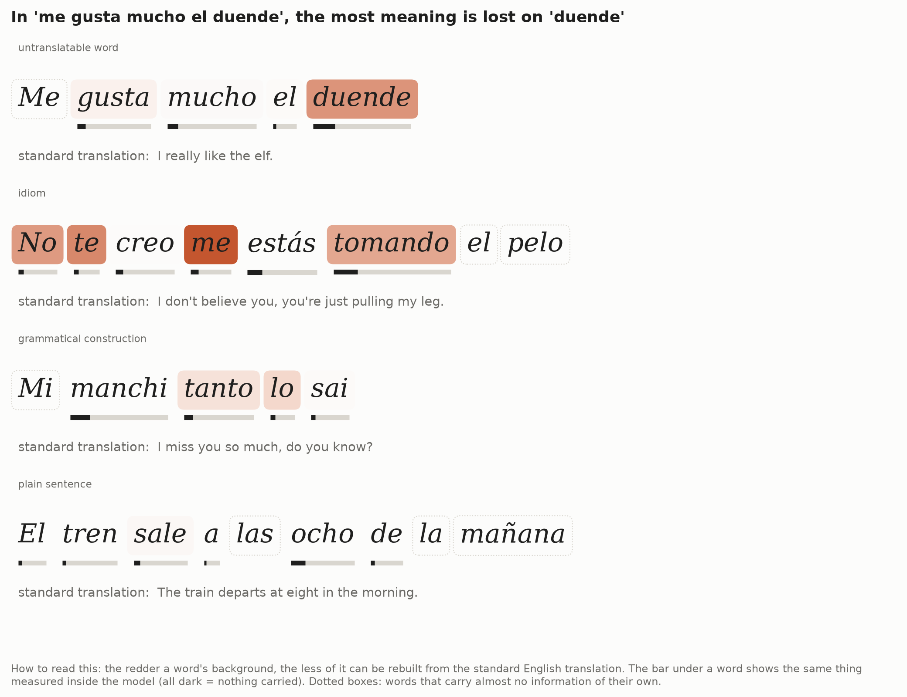  
How to read this: the redder a word's background, the less of it can be rebuilt from the standard English translation. The bar under a word shows the same thing measured inside the model (all dark = nothing carried). Dotted boxes: words that carry almost no information of their own.

**How much English it takes before the meaning gets across**  
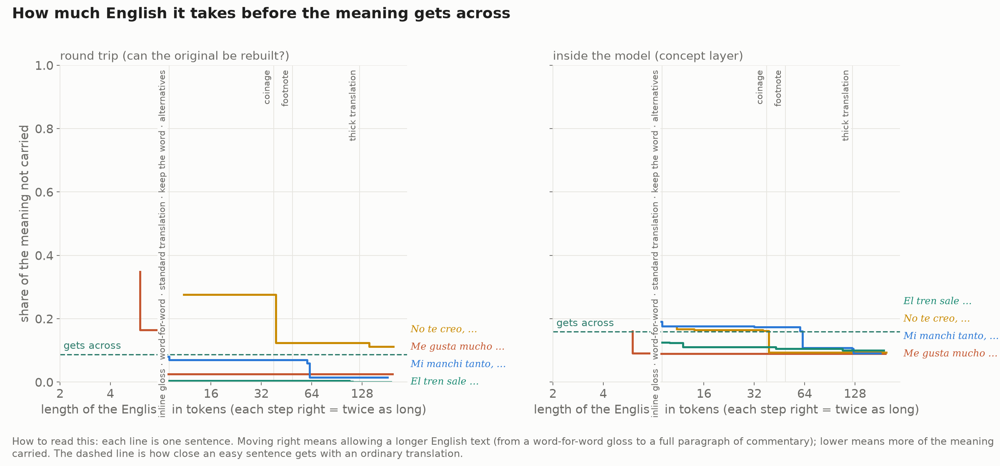  
How to read this: each line is one sentence. Moving right means allowing a longer English text (from a word-for-word gloss to a full paragraph of commentary); lower means more of the meaning carried. The dashed line is how close an easy sentence gets with an ordinary translation.

**Opening up a sentence instead of substituting word for word**  
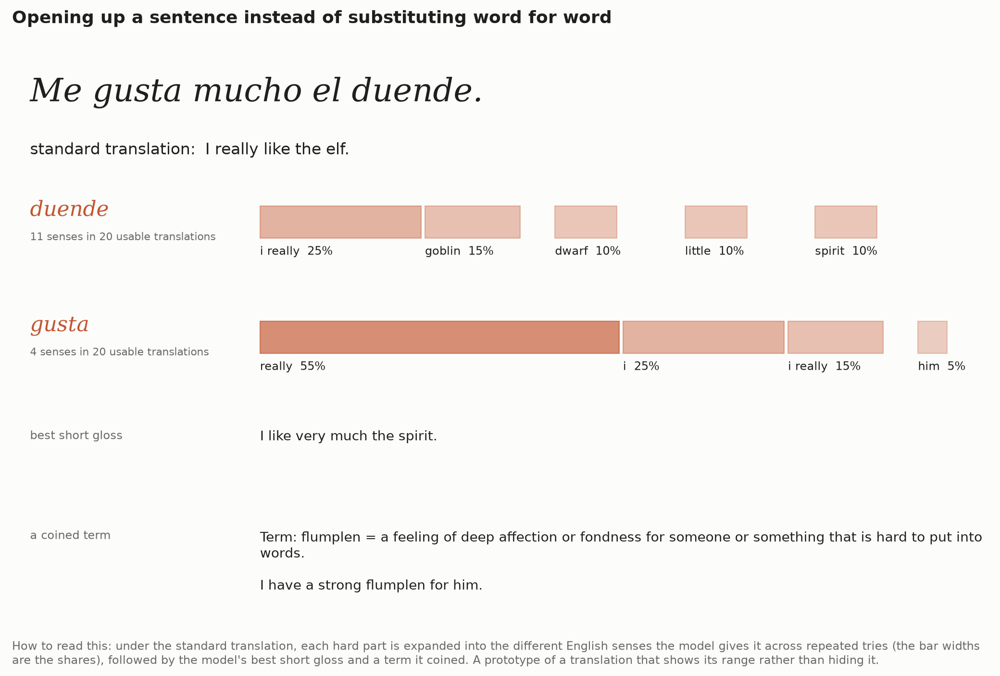  
How to read this: under the standard translation, each hard part is expanded into the different English senses the model gives it across repeated tries (the bar widths are the shares), followed by the model's best short gloss and a term it coined. A prototype of a translation that shows its range rather than hiding it.

**Glossing the marked words did not reliably beat glossing random words**  
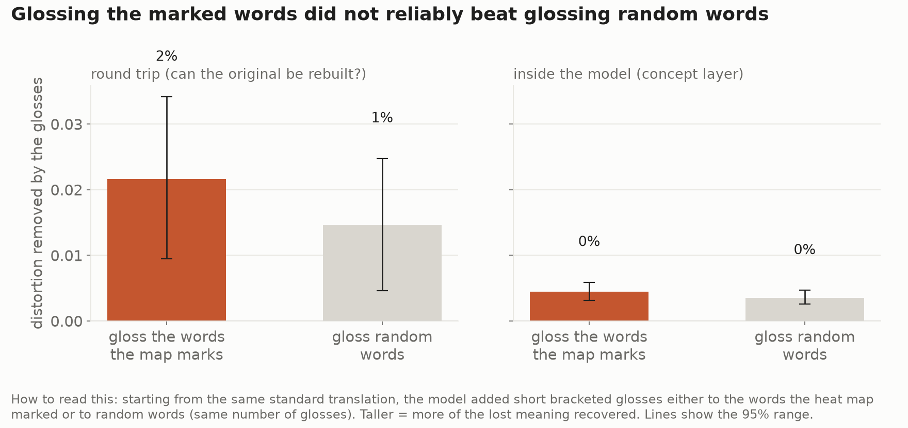  
How to read this: starting from the same standard translation, the model added short bracketed glosses either to the words the heat map marked or to random words (same number of glosses). Taller = more of the lost meaning recovered. Lines show the 95% range.

**Doublings of length needed, average by kind of sentence: plain 0.2, untranslatable word 1.7, construction 1.0, idiom 0.6, dialect 2.5**  
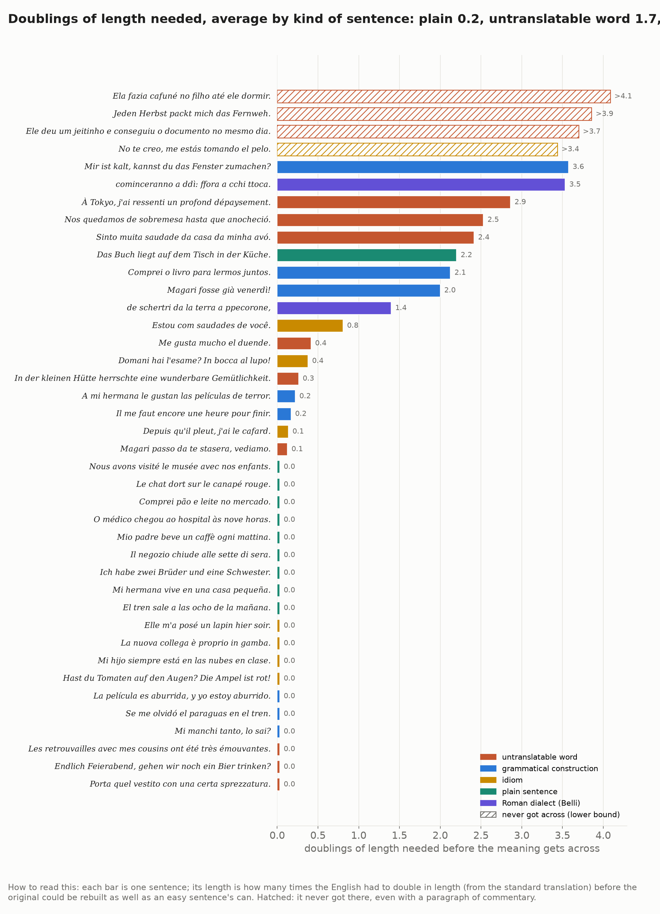  
How to read this: each bar is one sentence; its length is how many times the English had to double in length (from the standard translation) before the original could be rebuilt as well as an easy sentence's can. Hatched: it never got there, even with a paragraph of commentary.

**The two ways of measuring only partly agree (rank correlation 0.24)**  
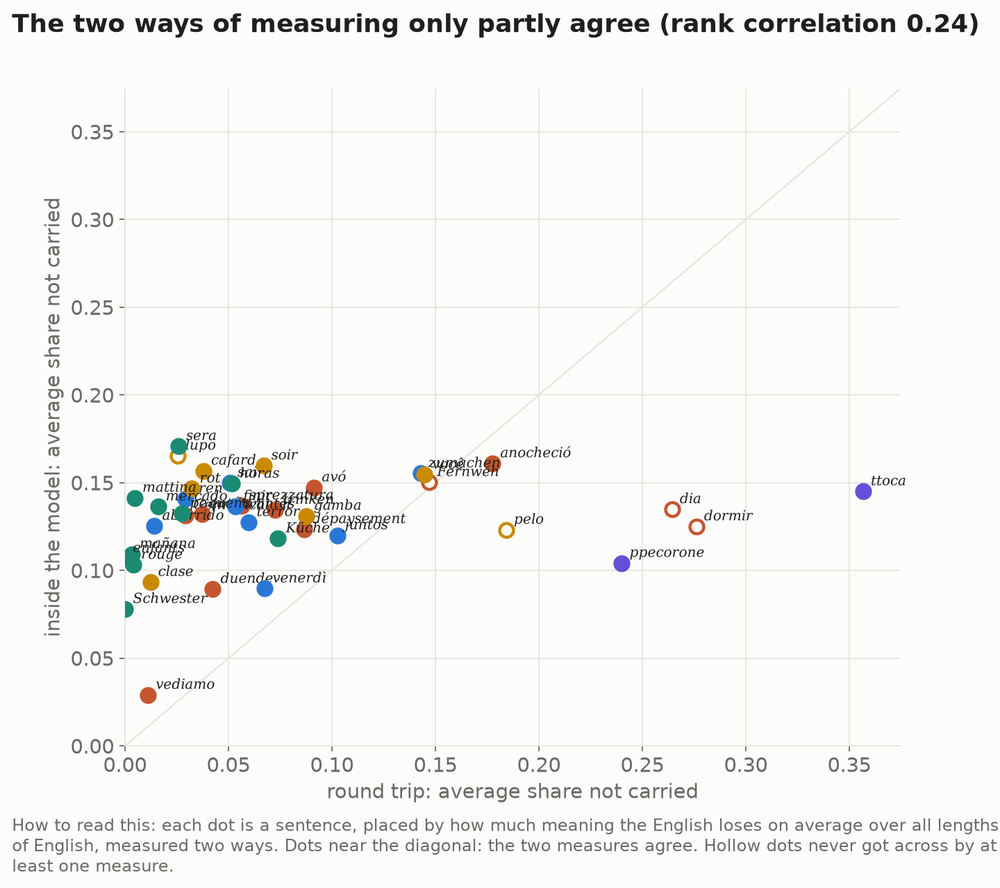  
How to read this: each dot is a sentence, placed by how much meaning the English loses on average over all lengths of English, measured two ways. Dots near the diagonal: the two measures agree. Hollow dots never got across by at least one measure.

## Qwen/Qwen2.5-7B-Instruct (nf4)

Validation raised no stop flags.

### Validation (§6)

- **Layer for d_CL:** 12 (neighbours [11, 13]), tau = 2.51189; AUROC matched vs mismatched controls 1.000 (95% CI 1.00-1.00). Layers where the spelling control won: [1, 2, 3, 27, 28].
- **Tolerance epsilon** (90th percentile of d(control, B1)): round trip 0.140, concept layer 0.194.
- **Ladder (round trip):** best B6 minus best B1 = -0.167 (-0.223 to -0.110); passed. Spearman of rung length vs mean best d: -0.74.
- **Heat map (round trip):** AUROC of word leftover, annotated hot words vs other content words: 0.638 (CI 0.54-0.73; 67 hot, 52 other).
- **Ladder (concept layer):** best B6 minus best B1 = -0.047 (-0.058 to -0.036); passed. Spearman of rung length vs mean best d: -0.69.
- **Heat map (concept layer):** AUROC of word leftover, annotated hot words vs other content words: 0.696 (CI 0.60-0.79; 67 hot, 52 other).
- **Me gusta mucho el duende (rt):** leftover duende 0.02, gusta 0.07, mucho 0.15 (n/a = the word carries no information weight); expected order duende > gusta > mucho does not hold.
- **Me gusta mucho el duende (cl):** leftover duende 0.26, gusta 0.18, mucho 0.15 (n/a = the word carries no information weight); expected order duende > gusta > mucho holds.
- **Agreement of the two spaces:** Spearman across sentences, A 0.42 (n=40), U 0.43; per-token leftover on B1 0.47 (n=297).
- **Second back-translator meta-llama/Llama-3.2-3B-Instruct (bf16):** Spearman of A with the main round trip 0.75 (n=40).
- **Second back-translator meta-llama/Llama-3.1-8B-Instruct (nf4):** Spearman of A with the main round trip 0.63 (n=40).
- **Second back-translator CohereForAI/aya-23-8B (nf4):** Spearman of A with the main round trip 0.65 (n=40).

### English detour (§6.5)

d_CL of the greedy standard translation at the concept layer vs the detour layers [18, 19, 20, 21, 22] (negative = the English looks closer in the detour layers).

| category | n | concept layer | detour | detour - concept (95% CI) |
|---|---|---|---|---|
| untranslatable_in_context | 12 | 0.192 | 0.158 | -0.033 (-0.038 to -0.029) |
| construction | 8 | 0.184 | 0.155 | -0.028 (-0.032 to -0.024) |
| idiom | 8 | 0.202 | 0.165 | -0.037 (-0.041 to -0.032) |
| dialect | 2 | 0.239 | 0.194 | -0.045 (-0.045 to -0.044) |
| control | 10 | 0.146 | 0.126 | -0.021 (-0.024 to -0.017) |

### Spelling / copying check (§2.1, §2.2)

| space | gain of B2 (keep the word) | B2 gain with source words masked | share surviving | gain of B3 (gloss) |
|---|---|---|---|---|
| rt | 0.129 | -0.055 | -0.42 | 0.010 |
| cl | 0.026 | -0.003 | -0.10 | 0.008 |

### Untranslatability by category

U = doublings of length beyond the standard translation before d <= epsilon (censored = never reached; the bound is used). A = mean distortion over log-spaced lengths from L0 to L0 x 2^4.25.

| category | n | U round trip | censored | U concept | censored | A round trip | A concept |
|---|---|---|---|---|---|---|---|
| untranslatable_in_context | 12 | 0.67 | 0/12 | 0.46 | 0/12 | 0.044 | 0.107 |
| construction | 8 | 0.15 | 0/8 | 0.44 | 0/8 | 0.046 | 0.124 |
| idiom | 8 | 0.31 | 0/8 | 1.02 | 1/8 | 0.037 | 0.133 |
| dialect | 2 | 1.33 | 0/2 | 0.47 | 0/2 | 0.176 | 0.104 |
| control | 10 | 0.02 | 0/10 | 0.41 | 0/10 | 0.007 | 0.117 |

### Per sentence

| sentence | category | standard translation | U rt | U cl | hot spans: U rt (construction gap) |
|---|---|---|---|---|---|
| *Me gusta mucho el duende.* | untranslatable_in_context | I really like the gnome. | 0.00 | 0.42 | *duende* 0.00; *gusta* 0.00 |
| *Sinto muita saudade da casa da minha avó.* | untranslatable_in_context | I miss my grandmother's house very much. | 0.15 | 0.53 | *saudade* 0.00 |
| *Nos quedamos de sobremesa hasta que anocheció.* | untranslatable_in_context | We stayed for dessert until it grew dark. | 2.26 | 0.29 | *de sobremesa* 2.26 (gap +0.00) |
| *Jeden Herbst packt mich das Fernweh.* | untranslatable_in_context | Every autumn, wanderlust grips me. | 1.81 | 4.25 | *Fernweh* 0.17; *packt mich* 2.21 (gap -0.04) |
| *Porta quel vestito con una certa sprezzatura.* | untranslatable_in_context | She wore that dress with a certain nonchalance. | 0.00 | 0.00 | *sprezzatura* 0.00 |
| *Magari passo da te stasera, vediamo.* | untranslatable_in_context | I hope I can drop by at your place tonight, let's see. | 0.00 | 0.00 | *Magari* 0.00 |
| *Ele deu um jeitinho e conseguiu o documento no mesmo dia.* | untranslatable_in_context | He found a way to get the document on the same day. | 0.21 | 0.00 | *deu um jeitinho* 0.21 (gap +0.00) |
| *Ela fazia cafuné no filho até ele dormir.* | untranslatable_in_context | She ran her hands through her son's hair until he fell asleep. | 3.51 | 0.00 | *fazia cafuné* 3.51 (gap +0.00) |
| *In der kleinen Hütte herrschte eine wunderbare Gemütlichkeit.* | untranslatable_in_context | In the small cottage, there was a wonderful coziness. | 0.00 | 0.00 | *Gemütlichkeit* 0.12 |
| *Endlich Feierabend, gehen wir noch ein Bier trinken?* | untranslatable_in_context | Finally the workday is over, let's go get a beer? | 0.10 | 0.00 | *Feierabend* 0.00 |
| *À Tokyo, j'ai ressenti un profond dépaysement.* | untranslatable_in_context | In Tokyo, I experienced a profound sense of dislocation. | 0.00 | 0.00 | *dépaysement* 0.00 |
| *Les retrouvailles avec mes cousins ont été très émouvantes.* | untranslatable_in_context | Reunions with my cousins were very touching. | 0.00 | 0.00 | *retrouvailles* 0.00 |
| *A mi hermana le gustan las películas de terror.* | construction | My sister likes horror movies. | 1.22 | 0.00 | *le gustan* 0.00 |
| *Mi manchi tanto, lo sai?* | construction | You miss me so much, you know? | 0.00 | 0.00 | *Mi manchi* 0.00 (gap +0.00) |
| *Se me olvidó el paraguas en el tren.* | construction | I forgot my umbrella on the train. | 0.00 | 0.32 | *Se me olvidó* 0.00 (gap +0.00) |
| *Mir ist kalt, kannst du das Fenster zumachen?* | construction | I'm cold, can you close the window? | 0.00 | 1.81 | *Mir ist kalt* 0.00 (gap +0.00) |
| *La película es aburrida, y yo estoy aburrido.* | construction | The movie is boring, and I am bored. | 0.00 | 0.00 | *es aburrida* 0.00; *estoy aburrido* 0.49 (gap +0.00) |
| *Il me faut encore une heure pour finir.* | construction | I still need an hour to finish. | 0.00 | 0.00 | *Il me faut* 0.81 |
| *Comprei o livro para lermos juntos.* | construction | I bought the book so we could read it together. | 0.00 | 0.00 | *lermos* >3.92 |
| *Magari fosse già venerdì!* | construction | If only it were already Friday! | 0.00 | 1.36 | *Magari fosse* 0.00 (gap +0.00) |
| *No te creo, me estás tomando el pelo.* | idiom | You're not convincing me, you're pulling my leg. | 0.00 | 0.00 | *me estás tomando el pelo* 0.00 |
| *Domani hai l'esame? In bocca al lupo!* | idiom | Are you taking your exam tomorrow? Good luck! | 0.00 | 0.49 | *In bocca al lupo* 0.49 |
| *Depuis qu'il pleut, j'ai le cafard.* | idiom | Since it's been raining, I'm feeling blue. | 0.00 | 0.24 | *j'ai le cafard* 0.00 (gap +0.00) |
| *Hast du Tomaten auf den Augen? Die Ampel ist rot!* | idiom | Do you have tomatoes on your eyes? The traffic light is red! | 0.00 | 0.00 | *Tomaten auf den Augen* 0.00 (gap +0.00) |
| *Estou com saudades de você.* | idiom | I miss you. | 0.81 | >5.04 | *Estou com saudades* 0.81 (gap +0.00) |
| *Mi hijo siempre está en las nubes en clase.* | idiom | My son is always daydreaming in class. | 0.00 | 0.00 | *está en las nubes* 0.00 |
| *La nuova collega è proprio in gamba.* | idiom | The new colleague is really capable. | 0.36 | 0.00 | *in gamba* 0.36 (gap -0.64) |
| *Elle m'a posé un lapin hier soir.* | idiom | She pulled a fast one on me last night. | 1.32 | 2.38 | *m'a posé un lapin* 1.32 (gap +0.00) |
| *cominceranno a ddì: ffora a cchi ttoca.* | dialect | They will start to say: out of this comes. | 1.97 | 0.24 | *ffora a cchi ttoca* 1.97 (gap +0.00) |
| *de schertri da la terra a ppecorone,* | dialect | From the earth to the sheepfold, | 0.70 | 0.70 | *schertri* 0.70; *a ppecorone* 0.00 (gap +0.00) |
| *El tren sale a las ocho de la mañana.* | control | The train departs at eight in the morning. | 0.00 | 0.00 |  |
| *Mi hermana vive en una casa pequeña.* | control | My sister lives in a small house. | 0.00 | 0.00 |  |
| *Ich habe zwei Brüder und eine Schwester.* | control | I have two brothers and a sister. | 0.00 | 0.00 |  |
| *Das Buch liegt auf dem Tisch in der Küche.* | control | The book is on the table in the kitchen. | 0.00 | 0.00 |  |
| *Il negozio chiude alle sette di sera.* | control | The store closes at 7 PM. | 0.17 | 4.06 |  |
| *Mio padre beve un caffè ogni mattina.* | control | My father drinks coffee every morning. | 0.00 | 0.00 |  |
| *O médico chegou ao hospital às nove horas.* | control | The doctor arrived at the hospital at nine o'clock. | 0.00 | 0.00 |  |
| *Comprei pão e leite no mercado.* | control | I bought bread and milk at the market. | 0.00 | 0.00 |  |
| *Le chat dort sur le canapé rouge.* | control | The cat sleeps on the red sofa. | 0.00 | 0.00 |  |
| *Nous avons visité le musée avec nos enfants.* | control | We visited the museum with our children. | 0.00 | 0.00 |  |

### Spread over standard translations (§1)

20 standard translations at T=1.0; H in bits over NLI meaning clusters.

| sentence | span | kind | H | clusters | usable | top renderings |
|---|---|---|---|---|---|---|
| es_duende | *duende* | hot | 2.16 | 7 | 20/20 | gnome 50%, sprite 20%, dwarf 10% |
| es_duende | *gusta* | hot | 0.47 | 2 | 20/20 | really like 90%, really 10% |
| pt_saudade | *saudade* | hot | 0.00 | 1 | 20/20 | miss 100% |
| es_sobremesa | *de sobremesa* | hot | 0.75 | 3 | 20/20 | for dessert 85%, for dinner 10%, for evening 5% |
| de_fernweh | *Fernweh* | hot | 1.39 | 6 | 20/20 | wanderlust 75%, every autumn, i feel a strong urge to travel 5%, longing 5% |
| de_fernweh | *packt mich* | hot | 2.08 | 7 | 20/20 | wanderlust grips 55%, wanderlust 15%, feel 10% |
| it_sprezzatura | *sprezzatura* | hot | 1.82 | 4 | 19/20 | grace 37%, nonchalance 37%, effortless charm 16% |
| it_magari_forse | *Magari* | hot | 1.19 | 3 | 20/20 | maybe 60%, i hope 35%, i'll drop by 5% |
| pt_jeitinho | *deu um jeitinho* | hot | 0.61 | 2 | 20/20 | found a 85%, found a way 15% |
| pt_cafune | *fazia cafuné* | hot | n/a | 3 | 3/20 | stroked 33%, combed through 33%, caressed 33% |
| de_gemuetlichkeit | *Gemütlichkeit* | hot | 0.29 | 2 | 20/20 | coziness 95%, wonderful coziness 5% |
| de_feierabend | *Feierabend* | hot | 0.00 | 1 | 20/20 | finally 100% |
| fr_depaysement | *dépaysement* | hot | 0.91 | 3 | 19/20 | sense of displacement 79%, a profound sense of dislocation 16%, a profound sense of being out of my element 5% |
| fr_retrouvailles | *retrouvailles* | hot | 0.00 | 1 | 20/20 | reunions 100% |
| es_gustar | *le gustan* | hot | 0.00 | 1 | 20/20 | likes 100% |
| it_mi_manchi | *Mi manchi* | hot | 1.28 | 3 | 20/20 | you miss me 65%, you mean so much to me, you know 20%, i miss you 15% |
| es_se_me_olvido | *Se me olvidó* | hot | 0.29 | 2 | 20/20 | i forgot 95%, left 5% |
| de_mir_ist_kalt | *Mir ist kalt* | hot | 0.00 | 1 | 20/20 | i'm 100% |
| es_ser_estar | *es aburrida* | hot | 0.00 | 1 | 20/20 | the movie 100% |
| es_ser_estar | *estoy aburrido* | hot | 0.00 | 1 | 20/20 | i am 100% |
| fr_il_me_faut | *Il me faut* | hot | 0.00 | 1 | 20/20 | still need 100% |
| pt_infinitivo_pessoal | *lermos* | hot | 0.00 | 1 | 20/20 | we could read 100% |
| it_magari_wish | *Magari fosse* | hot | 0.00 | 1 | 20/20 | if only 100% |
| es_tomar_el_pelo | *me estás tomando el pelo* | hot | 0.57 | 3 | 20/20 | you're pulling my leg 90%, joking 5%, pulling my leg 5% |
| it_in_bocca_al_lupo | *In bocca al lupo* | hot | 1.00 | 2 | 19/20 | good luck 53%, break a leg 47% |
| fr_cafard | *j'ai le cafard* | hot | 0.00 | 1 | 20/20 | i'm feeling blue 100% |
| de_tomaten | *Tomaten auf den Augen* | hot | 0.00 | 1 | 20/20 | do you have tomatoes on your eyes 100% |
| pt_estou_com_saudades | *Estou com saudades* | hot | 0.00 | 1 | 20/20 | i miss 100% |
| es_en_las_nubes | *está en las nubes* | hot | 1.72 | 4 | 20/20 | zoning out 45%, daydreaming 30%, lost in thought 20% |
| it_in_gamba | *in gamba* | hot | 0.00 | 1 | 19/20 | really capable 100% |
| fr_poser_un_lapin | *m'a posé un lapin* | hot | 1.05 | 3 | 20/20 | she pulled a fast one on me 75%, she stood me up 15%, she 10% |
| es_tren | *tren* | probe | 0.00 | 1 | 20/20 | the train 100% |
| es_casa | *casa* | probe | 0.00 | 1 | 20/20 | small house 100% |
| de_brueder | *Brüder* | probe | 0.00 | 1 | 20/20 | brothers 100% |
| de_tisch | *Tisch* | probe | 0.00 | 1 | 20/20 | table 100% |
| it_negozio | *negozio* | probe | 0.00 | 1 | 20/20 | the store 100% |
| it_caffe | *caffè* | probe | 0.00 | 1 | 20/20 | coffee 100% |
| pt_medico | *médico* | probe | 0.00 | 1 | 20/20 | the 100% |
| pt_mercado | *leite* | probe | 0.00 | 1 | 20/20 | milk 100% |
| fr_chat | *canapé* | probe | 0.88 | 2 | 20/20 | sofa 70%, couch 30% |
| fr_musee | *enfants* | probe | 0.00 | 1 | 20/20 | children 100% |
| rom_ffora | *ffora a cchi ttoca* | hot | 3.05 | 10 | 19/20 | out it falls 21%, out of this comes 21%, out it falls to 16% |
| rom_schertri | *schertri* | hot | 1.97 | 6 | 19/20 | from the 53%, from 21%, from the earth 11% |
| rom_schertri | *a ppecorone* | hot | 2.66 | 8 | 19/20 | to the sheepfold 32%, mountains 21%, to the mountain sheep 16% |

Mean H: hot spans 0.77 bits (n=33), control probe words 0.09 bits (n=10).

### Targeting test (§3)

Glosses chosen by the rt heat map. Cut = distortion of the standard translation minus distortion after the glosses (positive = the glosses helped).

| space | cut, targeted | cut, random | targeted - random (95% CI) | sentences where targeted won |
|---|---|---|---|---|
| rt | +0.007 (-0.002 to +0.016) | +0.000 (-0.006 to +0.007) | +0.007 (-0.001 to +0.016) | 62% |
| cl | +0.002 (+0.001 to +0.004) | +0.002 (+0.001 to +0.003) | +0.000 (-0.000 to +0.001) | 54% |

Tokens added: targeted 6.0, random 6.0.

### Figures

**In 'me gusta mucho el duende', the most meaning is lost on 'gusta'**  
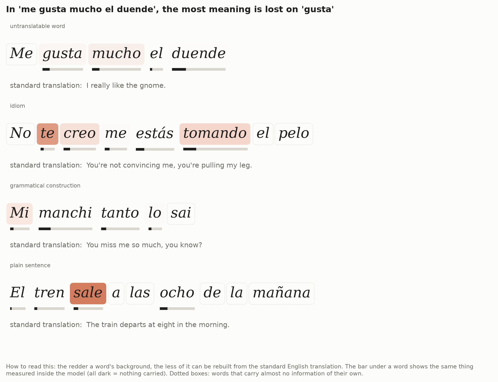  
How to read this: the redder a word's background, the less of it can be rebuilt from the standard English translation. The bar under a word shows the same thing measured inside the model (all dark = nothing carried). Dotted boxes: words that carry almost no information of their own.

**How much English it takes before the meaning gets across**  
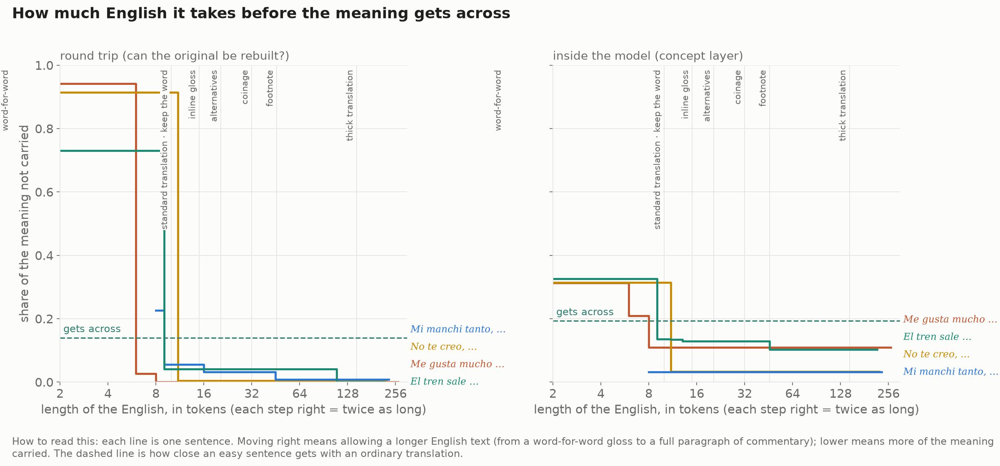  
How to read this: each line is one sentence. Moving right means allowing a longer English text (from a word-for-word gloss to a full paragraph of commentary); lower means more of the meaning carried. The dashed line is how close an easy sentence gets with an ordinary translation.

**Opening up a sentence instead of substituting word for word**  
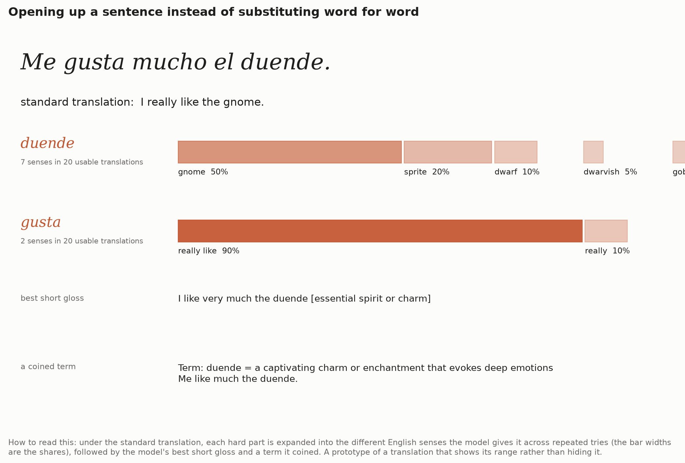  
How to read this: under the standard translation, each hard part is expanded into the different English senses the model gives it across repeated tries (the bar widths are the shares), followed by the model's best short gloss and a term it coined. A prototype of a translation that shows its range rather than hiding it.

**Glossing the marked words did not reliably beat glossing random words**  
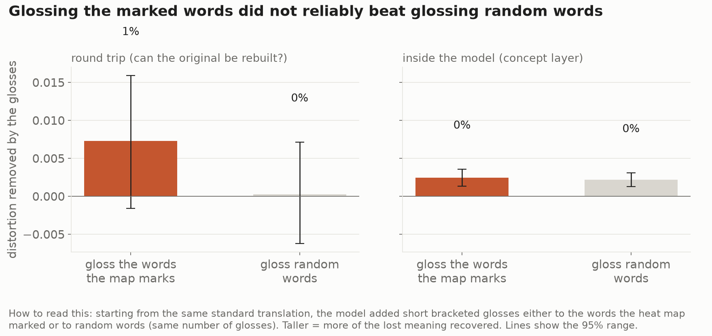  
How to read this: starting from the same standard translation, the model added short bracketed glosses either to the words the heat map marked or to random words (same number of glosses). Taller = more of the lost meaning recovered. Lines show the 95% range.

**Doublings of length needed, average by kind of sentence: plain 0.0, untranslatable word 0.7, construction 0.2, idiom 0.3, dialect 1.3**  
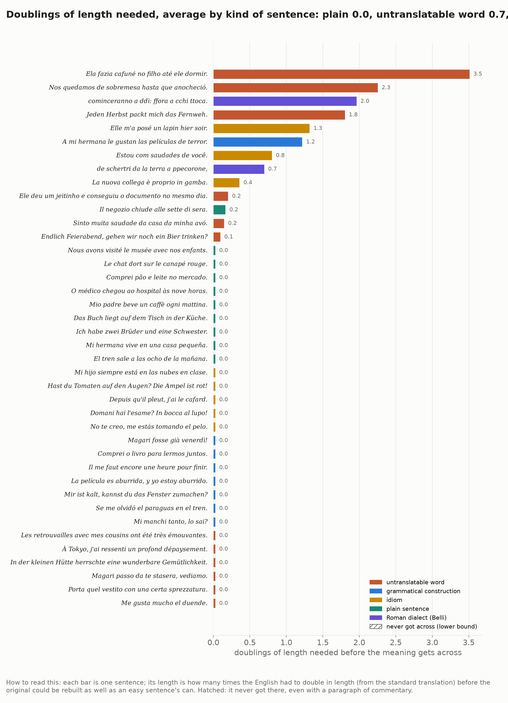  
How to read this: each bar is one sentence; its length is how many times the English had to double in length (from the standard translation) before the original could be rebuilt as well as an easy sentence's can. Hatched: it never got there, even with a paragraph of commentary.

**The two ways of measuring only partly agree (rank correlation 0.42)**  
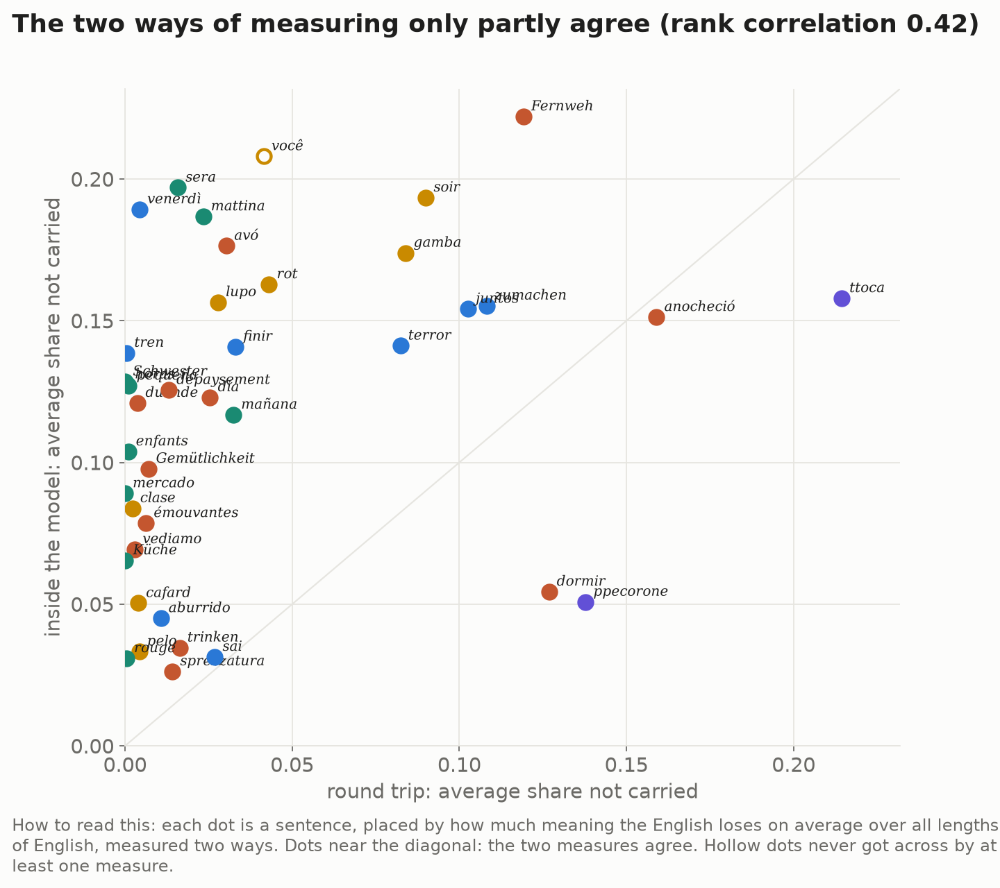  
How to read this: each dot is a sentence, placed by how much meaning the English loses on average over all lengths of English, measured two ways. Dots near the diagonal: the two measures agree. Hollow dots never got across by at least one measure.

## CohereForAI/aya-23-8B (nf4)

Validation raised no stop flags.

### Validation (§6)

- **Layer for d_CL:** 16 (neighbours [15, 17]), tau = 1.99526; AUROC matched vs mismatched controls 1.000 (95% CI 1.00-1.00). Layers where the spelling control won: [1, 2].
- **Tolerance epsilon** (90th percentile of d(control, B1)): round trip 0.180, concept layer 0.176.
- **Ladder (round trip):** best B6 minus best B1 = -0.064 (-0.120 to -0.017); passed. Spearman of rung length vs mean best d: -0.20.
- **Heat map (round trip):** AUROC of word leftover, annotated hot words vs other content words: 0.684 (CI 0.59-0.77; 70 hot, 56 other).
- **Ladder (concept layer):** best B6 minus best B1 = -0.031 (-0.043 to -0.020); passed. Spearman of rung length vs mean best d: -0.30.
- **Heat map (concept layer):** AUROC of word leftover, annotated hot words vs other content words: 0.697 (CI 0.61-0.79; 70 hot, 56 other).
- **Me gusta mucho el duende (rt):** leftover duende 0.00, gusta 0.00, mucho 0.00 (n/a = the word carries no information weight); expected order duende > gusta > mucho does not hold.
- **Me gusta mucho el duende (cl):** leftover duende 0.13, gusta 0.19, mucho 0.20 (n/a = the word carries no information weight); expected order duende > gusta > mucho does not hold.
- **Agreement of the two spaces:** Spearman across sentences, A 0.55 (n=40), U 0.30; per-token leftover on B1 0.40 (n=335).
- **Second back-translator meta-llama/Llama-3.2-3B-Instruct (bf16):** Spearman of A with the main round trip 0.84 (n=40).
- **Second back-translator meta-llama/Llama-3.1-8B-Instruct (nf4):** Spearman of A with the main round trip 0.81 (n=40).
- **Second back-translator Qwen/Qwen2.5-7B-Instruct (nf4):** Spearman of A with the main round trip 0.75 (n=40).

### English detour (§6.5)

d_CL of the greedy standard translation at the concept layer vs the detour layers [21, 22, 23, 24, 25] (negative = the English looks closer in the detour layers).

| category | n | concept layer | detour | detour - concept (95% CI) |
|---|---|---|---|---|
| untranslatable_in_context | 12 | 0.213 | 0.180 | -0.033 (-0.039 to -0.026) |
| construction | 8 | 0.194 | 0.174 | -0.020 (-0.028 to -0.012) |
| idiom | 8 | 0.213 | 0.185 | -0.028 (-0.038 to -0.018) |
| dialect | 2 | 0.298 | 0.229 | -0.070 (-0.076 to -0.063) |
| control | 10 | 0.140 | 0.131 | -0.010 (-0.017 to -0.002) |

### Spelling / copying check (§2.1, §2.2)

| space | gain of B2 (keep the word) | B2 gain with source words masked | share surviving | gain of B3 (gloss) |
|---|---|---|---|---|
| rt | -0.040 | -0.040 | n/a | -0.009 |
| cl | -0.004 | -0.004 | n/a | 0.001 |

### Untranslatability by category

U = doublings of length beyond the standard translation before d <= epsilon (censored = never reached; the bound is used). A = mean distortion over log-spaced lengths from L0 to L0 x 2^4.0.

| category | n | U round trip | censored | U concept | censored | A round trip | A concept |
|---|---|---|---|---|---|---|---|
| untranslatable_in_context | 12 | 1.03 | 1/12 | 2.51 | 6/12 | 0.128 | 0.184 |
| construction | 8 | 0.00 | 0/8 | 2.44 | 1/8 | 0.049 | 0.172 |
| idiom | 8 | 0.23 | 0/8 | 1.46 | 1/8 | 0.076 | 0.151 |
| dialect | 2 | 1.65 | 0/2 | 1.65 | 0/2 | 0.331 | 0.192 |
| control | 10 | 0.00 | 0/10 | 0.00 | 0/10 | 0.003 | 0.137 |

### Per sentence

| sentence | category | standard translation | U rt | U cl | hot spans: U rt (construction gap) |
|---|---|---|---|---|---|
| *Me gusta mucho el duende.* | untranslatable_in_context | I like the duende a lot. | 0.00 | 0.00 | *duende* 0.00; *gusta* 0.00 |
| *Sinto muita saudade da casa da minha avó.* | untranslatable_in_context | I miss my grandmother's house a lot. | 0.00 | >4.03 | *saudade* 0.29 |
| *Nos quedamos de sobremesa hasta que anocheció.* | untranslatable_in_context | We stayed for the afternoon until it got dark. | 2.00 | 3.70 | *de sobremesa* 3.70 (gap +0.00) |
| *Jeden Herbst packt mich das Fernweh.* | untranslatable_in_context | Every fall I get the wanderlust. | 0.00 | >4.50 | *Fernweh* 0.00; *packt mich* 0.00 (gap -4.50) |
| *Porta quel vestito con una certa sprezzatura.* | untranslatable_in_context | Wear that dress with a certain nonchalance. | 0.00 | >3.62 | *sprezzatura* 2.18 |
| *Magari passo da te stasera, vediamo.* | untranslatable_in_context | Maybe I'll drop by tonight, we'll see. | 0.00 | >3.32 | *Magari* >3.32 |
| *Ele deu um jeitinho e conseguiu o documento no mesmo dia.* | untranslatable_in_context | He gave me a hand and got the document the same day. | 0.00 | 3.12 | *deu um jeitinho* 2.32 (gap +2.32) |
| *Ela fazia cafuné no filho até ele dormir.* | untranslatable_in_context | She rocked her son to sleep. | >4.62 | >4.62 | *fazia cafuné* >4.62 (gap +0.00) |
| *In der kleinen Hütte herrschte eine wunderbare Gemütlichkeit.* | untranslatable_in_context | In the little cabin there was a wonderful homey feeling. | 0.00 | >3.13 | *Gemütlichkeit* 0.00 |
| *Endlich Feierabend, gehen wir noch ein Bier trinken?* | untranslatable_in_context | Finally, end of work, let's go for a beer? | 3.65 | 0.11 | *Feierabend* 0.00 |
| *À Tokyo, j'ai ressenti un profond dépaysement.* | untranslatable_in_context | In Tokyo, I felt a deep sense of disorientation. | 2.06 | 0.00 | *dépaysement* >3.21 |
| *Les retrouvailles avec mes cousins ont été très émouvantes.* | untranslatable_in_context | Meeting up with my cousins was very emotional. | 0.00 | 0.00 | *retrouvailles* 0.00 |
| *A mi hermana le gustan las películas de terror.* | construction | My sister likes horror movies. | 0.00 | 4.97 | *le gustan* 0.00 (gap +0.00) |
| *Mi manchi tanto, lo sai?* | construction | I miss you so much, you know? | 0.00 | 3.76 | *Mi manchi* 0.00 (gap -0.15) |
| *Se me olvidó el paraguas en el tren.* | construction | I forgot my umbrella on the train. | 0.00 | 4.10 | *Se me olvidó* 0.00 (gap -4.10) |
| *Mir ist kalt, kannst du das Fenster zumachen?* | construction | I'm cold, can you close the window? | 0.00 | 2.17 | *Mir ist kalt* 0.00 (gap -3.60) |
| *La película es aburrida, y yo estoy aburrido.* | construction | The movie is boring, and I am bored. | 0.00 | 0.00 | *es aburrida* 0.00 (gap +0.00); *estoy aburrido* 0.00 (gap +0.00) |
| *Il me faut encore une heure pour finir.* | construction | I still need another hour to finish. | 0.00 | >4.52 | *Il me faut* 0.00 (gap +0.00) |
| *Comprei o livro para lermos juntos.* | construction | I bought the book so we could read it together. | 0.00 | 0.00 | *lermos* 0.00 |
| *Magari fosse già venerdì!* | construction | Maybe it would be Friday already! | 0.00 | 0.00 | *Magari fosse* 0.00 (gap +0.00) |
| *No te creo, me estás tomando el pelo.* | idiom | I don't believe you, you're pulling my leg. | 0.00 | 0.00 | *me estás tomando el pelo* 0.00 |
| *Domani hai l'esame? In bocca al lupo!* | idiom | Are you taking the exam tomorrow? Good luck! | 0.00 | 0.85 | *In bocca al lupo* 0.00 |
| *Depuis qu'il pleut, j'ai le cafard.* | idiom | Since it's raining, I'm depressed. | 1.22 | 2.58 | *j'ai le cafard* 1.42 (gap +0.19) |
| *Hast du Tomaten auf den Augen? Die Ampel ist rot!* | idiom | Are you blind? The light is red! | 0.29 | 1.74 | *Tomaten auf den Augen* 0.29 |
| *Estou com saudades de você.* | idiom | I miss you. | 0.32 | >6.08 | *Estou com saudades* 0.32 (gap +0.00) |
| *Mi hijo siempre está en las nubes en clase.* | idiom | My son is always in the clouds in class. | 0.00 | 0.00 | *está en las nubes* 0.00 (gap +0.00) |
| *La nuova collega è proprio in gamba.* | idiom | The new colleague is just great. | 0.00 | 0.00 | *in gamba* 2.84 (gap +2.47) |
| *Elle m'a posé un lapin hier soir.* | idiom | She gave me a rabbit last night. | 0.00 | 0.46 | *m'a posé un lapin* 0.17 (gap +0.00) |
| *cominceranno a ddì: ffora a cchi ttoca.* | dialect | They will begin to say: "It's getting hot." | 1.12 | 1.12 | *ffora a cchi ttoca* 1.12 (gap +0.00) |
| *de schertri da la terra a ppecorone,* | dialect | the earth is full of fools. | 2.19 | 2.19 | *schertri* 1.28; *a ppecorone* 2.19 (gap +0.00) |
| *El tren sale a las ocho de la mañana.* | control | The train leaves at eight in the morning. | 0.00 | 0.00 |  |
| *Mi hermana vive en una casa pequeña.* | control | My sister lives in a small house. | 0.00 | 0.00 |  |
| *Ich habe zwei Brüder und eine Schwester.* | control | I have two brothers and one sister. | 0.00 | 0.00 |  |
| *Das Buch liegt auf dem Tisch in der Küche.* | control | The book is on the table in the kitchen. | 0.00 | 0.00 |  |
| *Il negozio chiude alle sette di sera.* | control | The store closes at 7 p.m. | 0.00 | 0.00 |  |
| *Mio padre beve un caffè ogni mattina.* | control | My father drinks a coffee every morning. | 0.00 | 0.00 |  |
| *O médico chegou ao hospital às nove horas.* | control | The doctor arrived at the hospital at nine o'clock. | 0.00 | 0.00 |  |
| *Comprei pão e leite no mercado.* | control | I bought bread and milk at the market. | 0.00 | 0.00 |  |
| *Le chat dort sur le canapé rouge.* | control | The cat sleeps on the red sofa. | 0.00 | 0.00 |  |
| *Nous avons visité le musée avec nos enfants.* | control | We visited the museum with our children. | 0.00 | 0.00 |  |

### Spread over standard translations (§1)

20 standard translations at T=1.0; H in bits over NLI meaning clusters.

| sentence | span | kind | H | clusters | usable | top renderings |
|---|---|---|---|---|---|---|
| es_duende | *duende* | hot | 0.00 | 1 | 20/20 | (nothing) 100% |
| es_duende | *gusta* | hot | 0.00 | 1 | 20/20 | (nothing) 100% |
| pt_saudade | *saudade* | hot | n/a | 1 | 3/20 | (nothing) 100% |
| es_sobremesa | *de sobremesa* | hot | 0.00 | 1 | 20/20 | (nothing) 100% |
| de_fernweh | *Fernweh* | hot | 0.29 | 2 | 20/20 | (nothing) 95%, wanderlust 5% |
| de_fernweh | *packt mich* | hot | 0.00 | 1 | 20/20 | (nothing) 100% |
| it_sprezzatura | *sprezzatura* | hot | 0.00 | 1 | 20/20 | (nothing) 100% |
| it_magari_forse | *Magari* | hot | 0.00 | 1 | 20/20 | (nothing) 100% |
| pt_jeitinho | *deu um jeitinho* | hot | 0.00 | 1 | 20/20 | (nothing) 100% |
| pt_cafune | *fazia cafuné* | hot | 0.81 | 2 | 20/20 | (nothing) 75%, rocked 25% |
| de_gemuetlichkeit | *Gemütlichkeit* | hot | 0.00 | 1 | 20/20 | (nothing) 100% |
| de_feierabend | *Feierabend* | hot | 0.85 | 4 | 20/20 | (nothing) 85%, happy hour 5%, good work 5% |
| fr_depaysement | *dépaysement* | hot | 0.00 | 1 | 20/20 | (nothing) 100% |
| fr_retrouvailles | *retrouvailles* | hot | 0.00 | 1 | 20/20 | (nothing) 100% |
| es_gustar | *le gustan* | hot | 0.00 | 1 | 20/20 | (nothing) 100% |
| it_mi_manchi | *Mi manchi* | hot | 1.61 | 5 | 17/20 | i miss you 65%, you're missed so much, you know 12%, you mean so much to me 12% |
| es_se_me_olvido | *Se me olvidó* | hot | 0.00 | 1 | 20/20 | (nothing) 100% |
| de_mir_ist_kalt | *Mir ist kalt* | hot | 1.48 | 4 | 20/20 | (nothing) 65%, it's cold 15%, it's cold in here 10% |
| es_ser_estar | *es aburrida* | hot | 0.00 | 1 | 20/20 | (nothing) 100% |
| es_ser_estar | *estoy aburrido* | hot | 0.00 | 1 | 20/20 | (nothing) 100% |
| fr_il_me_faut | *Il me faut* | hot | 1.15 | 4 | 20/20 | (nothing) 75%, it will take me another hour 15%, it'll take me 5% |
| pt_infinitivo_pessoal | *lermos* | hot | 0.00 | 1 | 20/20 | (nothing) 100% |
| it_magari_wish | *Magari fosse* | hot | 0.00 | 1 | 20/20 | (nothing) 100% |
| es_tomar_el_pelo | *me estás tomando el pelo* | hot | 0.00 | 1 | 20/20 | (nothing) 100% |
| it_in_bocca_al_lupo | *In bocca al lupo* | hot | 0.00 | 1 | 20/20 | good luck 100% |
| fr_cafard | *j'ai le cafard* | hot | 0.99 | 3 | 20/20 | (nothing) 75%, i've been feeling down 20%, it's raining and i'm feeling de saddened 5% |
| de_tomaten | *Tomaten auf den Augen* | hot | 0.00 | 1 | 20/20 | (nothing) 100% |
| pt_estou_com_saudades | *Estou com saudades* | hot | 0.72 | 2 | 20/20 | i miss you 80%, (nothing) 20% |
| es_en_las_nubes | *está en las nubes* | hot | 0.00 | 1 | 20/20 | (nothing) 100% |
| it_in_gamba | *in gamba* | hot | 0.00 | 1 | 20/20 | (nothing) 100% |
| fr_poser_un_lapin | *m'a posé un lapin* | hot | 0.00 | 1 | 20/20 | (nothing) 100% |
| es_tren | *tren* | probe | 0.00 | 1 | 20/20 | (nothing) 100% |
| es_casa | *casa* | probe | 0.00 | 1 | 20/20 | (nothing) 100% |
| de_brueder | *Brüder* | probe | 0.00 | 1 | 20/20 | (nothing) 100% |
| de_tisch | *Tisch* | probe | 0.00 | 1 | 20/20 | table 100% |
| it_negozio | *negozio* | probe | 0.61 | 2 | 20/20 | store 85%, (nothing) 15% |
| it_caffe | *caffè* | probe | 0.30 | 2 | 19/20 | coffee 95%, (nothing) 5% |
| pt_medico | *médico* | probe | 0.00 | 1 | 20/20 | (nothing) 100% |
| pt_mercado | *leite* | probe | 0.00 | 1 | 20/20 | (nothing) 100% |
| fr_chat | *canapé* | probe | 1.05 | 3 | 20/20 | sofa 75%, couch 15%, (nothing) 10% |
| fr_musee | *enfants* | probe | 0.00 | 1 | 20/20 | (nothing) 100% |
| rom_ffora | *ffora a cchi ttoca* | hot | 1.39 | 6 | 20/20 | (nothing) 75%, in the future anymore 5%, they'll even give you a hand 5% |
| rom_schertri | *schertri* | hot | 0.00 | 1 | 20/20 | (nothing) 100% |
| rom_schertri | *a ppecorone* | hot | 0.91 | 4 | 18/20 | (nothing) 83%, sheep 6%, suckling pig 6% |

Mean H: hot spans 0.31 bits (n=33), control probe words 0.20 bits (n=10).

### Targeting test (§3)

Glosses chosen by the rt heat map. Cut = distortion of the standard translation minus distortion after the glosses (positive = the glosses helped).

| space | cut, targeted | cut, random | targeted - random (95% CI) | sentences where targeted won |
|---|---|---|---|---|
| rt | +0.007 (-0.002 to +0.015) | +0.002 (-0.002 to +0.007) | +0.004 (-0.004 to +0.012) | 58% |
| cl | +0.005 (+0.002 to +0.008) | +0.002 (+0.001 to +0.004) | +0.002 (+0.000 to +0.005) | 62% |

Tokens added: targeted 6.8, random 6.4.

### Figures

**In 'me gusta mucho el duende', the most meaning is lost on 'Me'**  
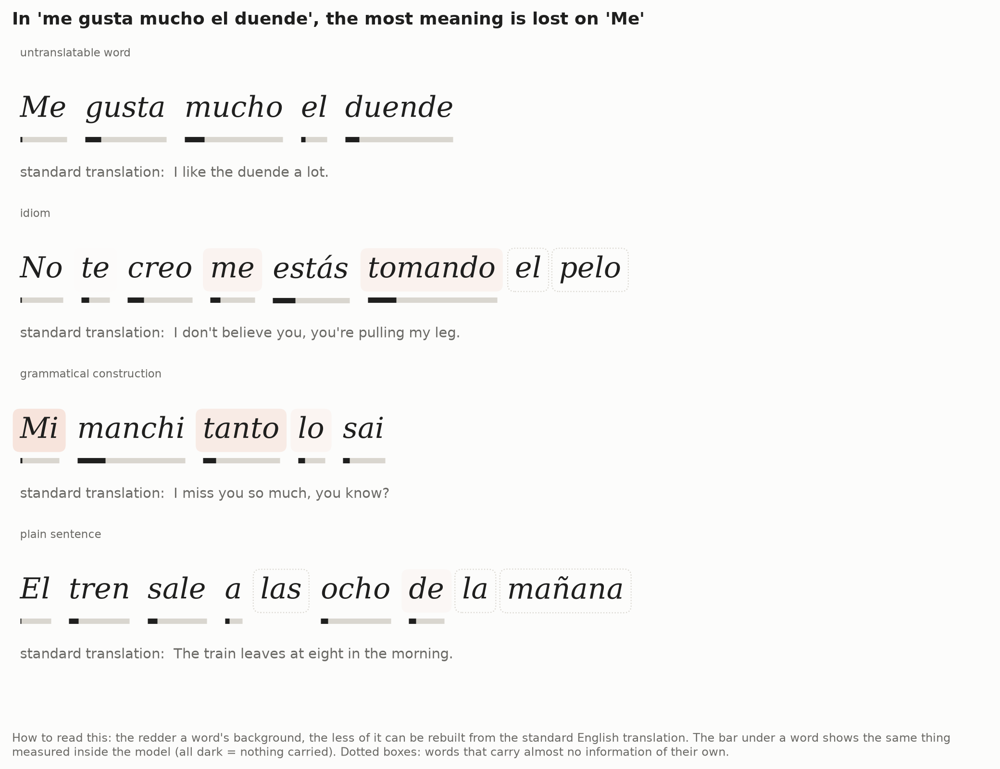  
How to read this: the redder a word's background, the less of it can be rebuilt from the standard English translation. The bar under a word shows the same thing measured inside the model (all dark = nothing carried). Dotted boxes: words that carry almost no information of their own.

**How much English it takes before the meaning gets across**  
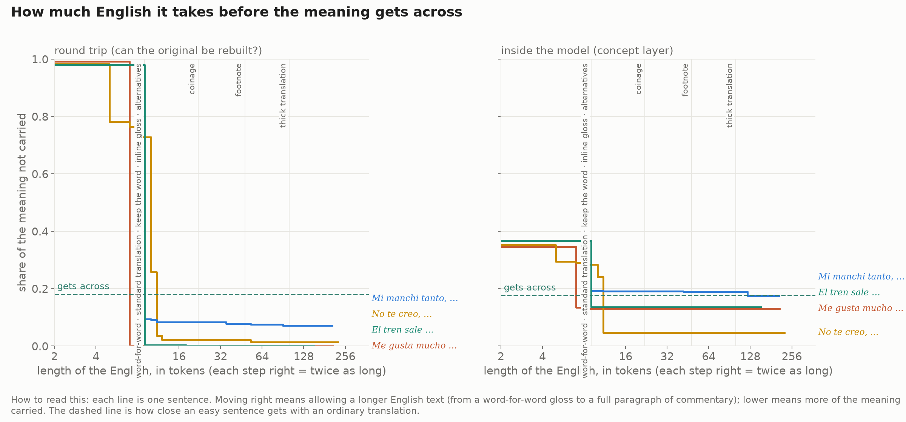  
How to read this: each line is one sentence. Moving right means allowing a longer English text (from a word-for-word gloss to a full paragraph of commentary); lower means more of the meaning carried. The dashed line is how close an easy sentence gets with an ordinary translation.

**Opening up a sentence instead of substituting word for word**  
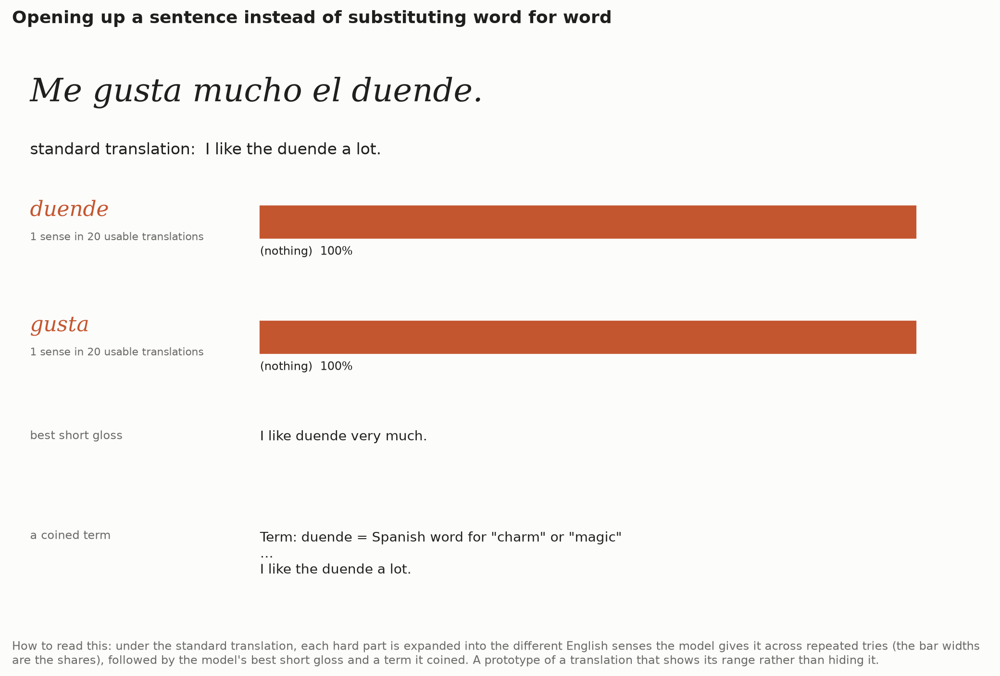  
How to read this: under the standard translation, each hard part is expanded into the different English senses the model gives it across repeated tries (the bar widths are the shares), followed by the model's best short gloss and a term it coined. A prototype of a translation that shows its range rather than hiding it.

**Glossing the marked words did not reliably beat glossing random words**  
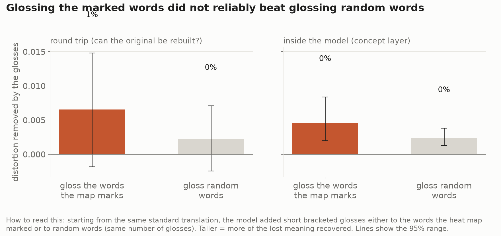  
How to read this: starting from the same standard translation, the model added short bracketed glosses either to the words the heat map marked or to random words (same number of glosses). Taller = more of the lost meaning recovered. Lines show the 95% range.

**Doublings of length needed, average by kind of sentence: plain 0.0, untranslatable word 1.0, construction 0.0, idiom 0.2, dialect 1.7**  
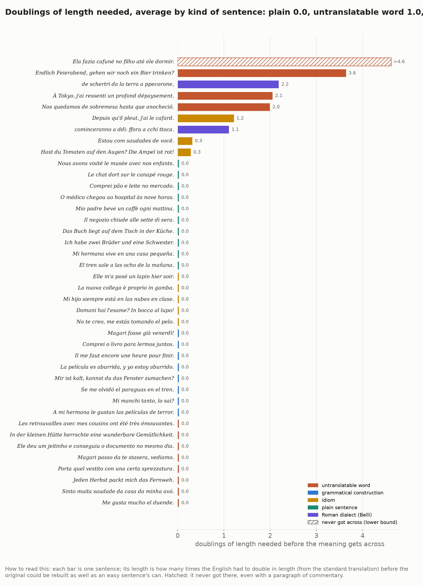  
How to read this: each bar is one sentence; its length is how many times the English had to double in length (from the standard translation) before the original could be rebuilt as well as an easy sentence's can. Hatched: it never got there, even with a paragraph of commentary.

**The two ways of measuring broadly agree (rank correlation 0.55)**  
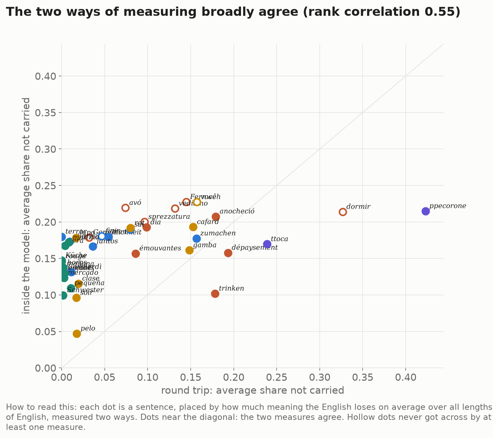  
How to read this: each dot is a sentence, placed by how much meaning the English loses on average over all lengths of English, measured two ways. Dots near the diagonal: the two measures agree. Hollow dots never got across by at least one measure.

## mistralai/Mistral-7B-Instruct-v0.3 (nf4)

Validation raised no stop flags.

### Validation (§6)

- **Layer for d_CL:** 20 (neighbours [19, 21]), tau = 3.98107; AUROC matched vs mismatched controls 0.979 (95% CI 0.96-0.99). Layers where the spelling control won: [1, 2, 3, 4, 5, 21, 22, 23, 24, 25, 26, 27, 28, 29, 30, 31, 32].
- **Tolerance epsilon** (90th percentile of d(control, B1)): round trip 0.176, concept layer 0.152.
- **Ladder (round trip):** best B6 minus best B1 = -0.177 (-0.235 to -0.125); passed. Spearman of rung length vs mean best d: -0.31.
- **Heat map (round trip):** AUROC of word leftover, annotated hot words vs other content words: 0.669 (CI 0.57-0.76; 73 hot, 54 other).
- **Ladder (concept layer):** best B6 minus best B1 = -0.039 (-0.049 to -0.032); passed. Spearman of rung length vs mean best d: -0.60.
- **Heat map (concept layer):** AUROC of word leftover, annotated hot words vs other content words: 0.651 (CI 0.56-0.75; 73 hot, 54 other).
- **Me gusta mucho el duende (rt):** leftover duende 0.00, gusta 0.33, mucho 0.06 (n/a = the word carries no information weight); expected order duende > gusta > mucho does not hold.
- **Me gusta mucho el duende (cl):** leftover duende 0.06, gusta 0.16, mucho 0.18 (n/a = the word carries no information weight); expected order duende > gusta > mucho does not hold.
- **Agreement of the two spaces:** Spearman across sentences, A 0.52 (n=40), U 0.45; per-token leftover on B1 0.28 (n=345).
- **Second back-translator meta-llama/Llama-3.2-3B-Instruct (bf16):** Spearman of A with the main round trip 0.84 (n=40).
- **Second back-translator meta-llama/Llama-3.1-8B-Instruct (nf4):** Spearman of A with the main round trip 0.84 (n=40).
- **Second back-translator CohereForAI/aya-23-8B (nf4):** Spearman of A with the main round trip 0.77 (n=40).
- **Second back-translator Qwen/Qwen2.5-7B-Instruct (nf4):** Spearman of A with the main round trip 0.70 (n=40).

### English detour (§6.5)

d_CL of the greedy standard translation at the concept layer vs the detour layers [21, 22, 23, 24, 25] (negative = the English looks closer in the detour layers).

| category | n | concept layer | detour | detour - concept (95% CI) |
|---|---|---|---|---|
| untranslatable_in_context | 12 | 0.147 | 0.152 | +0.005 (+0.004 to +0.006) |
| construction | 8 | 0.152 | 0.157 | +0.005 (+0.003 to +0.007) |
| idiom | 8 | 0.150 | 0.155 | +0.005 (+0.003 to +0.007) |
| dialect | 2 | 0.162 | 0.164 | +0.002 (+0.002 to +0.002) |
| control | 10 | 0.130 | 0.137 | +0.007 (+0.005 to +0.009) |

### Spelling / copying check (§2.1, §2.2)

| space | gain of B2 (keep the word) | B2 gain with source words masked | share surviving | gain of B3 (gloss) |
|---|---|---|---|---|
| rt | 0.085 | -0.008 | -0.09 | 0.161 |
| cl | 0.014 | -0.001 | -0.05 | 0.034 |

### Untranslatability by category

U = doublings of length beyond the standard translation before d <= epsilon (censored = never reached; the bound is used). A = mean distortion over log-spaced lengths from L0 to L0 x 2^4.75.

| category | n | U round trip | censored | U concept | censored | A round trip | A concept |
|---|---|---|---|---|---|---|---|
| untranslatable_in_context | 12 | 0.54 | 0/12 | 0.18 | 0/12 | 0.076 | 0.105 |
| construction | 8 | 0.68 | 0/8 | 0.66 | 0/8 | 0.083 | 0.110 |
| idiom | 8 | 0.49 | 0/8 | 0.35 | 0/8 | 0.055 | 0.112 |
| dialect | 2 | 2.81 | 0/2 | 0.00 | 0/2 | 0.259 | 0.111 |
| control | 10 | 0.13 | 0/10 | 0.19 | 0/10 | 0.016 | 0.100 |

### Per sentence

| sentence | category | standard translation | U rt | U cl | hot spans: U rt (construction gap) |
|---|---|---|---|---|---|
| *Me gusta mucho el duende.* | untranslatable_in_context | I really like the duende. | 0.00 | 0.00 | *duende* 0.00; *gusta* 0.00 |
| *Sinto muita saudade da casa da minha avó.* | untranslatable_in_context | I miss my grandmother's house a lot. | 0.15 | 0.00 | *saudade* 0.15 |
| *Nos quedamos de sobremesa hasta que anocheció.* | untranslatable_in_context | We stayed for after-dinner chat until it grew dark. | 1.37 | 0.22 | *de sobremesa* 1.84 (gap -2.06) |
| *Jeden Herbst packt mich das Fernweh.* | untranslatable_in_context | Every autumn, I get the travel bug. | 1.78 | 1.35 | *Fernweh* 0.00; *packt mich* 1.78 (gap +0.00) |
| *Porta quel vestito con una certa sprezzatura.* | untranslatable_in_context | Wear that dress with a certain nonchalance. | 0.00 | 0.00 | *sprezzatura* 1.40 |
| *Magari passo da te stasera, vediamo.* | untranslatable_in_context | Perhaps I'll pass by you tonight, see you. (Informal) | 0.31 | 0.00 | *Magari* 0.31 |
| *Ele deu um jeitinho e conseguiu o documento no mesmo dia.* | untranslatable_in_context | He found a way and managed to get the document on the same day. | 0.26 | 0.09 | *deu um jeitinho* 1.49 (gap +1.39) |
| *Ela fazia cafuné no filho até ele dormir.* | untranslatable_in_context | She was combing her son's hair until he fell asleep. | 0.00 | 0.00 | *fazia cafuné* 0.00 (gap -3.96) |
| *In der kleinen Hütte herrschte eine wunderbare Gemütlichkeit.* | untranslatable_in_context | A wonderful coziness reigned in the little cottage. | 0.00 | 0.00 | *Gemütlichkeit* 0.00 |
| *Endlich Feierabend, gehen wir noch ein Bier trinken?* | untranslatable_in_context | Shall we go for a beer after work, finally? | 2.46 | 0.50 | *Feierabend* 0.66 |
| *À Tokyo, j'ai ressenti un profond dépaysement.* | untranslatable_in_context | In Tokyo, I felt a profound homesickness. | 0.14 | 0.00 | *dépaysement* 0.26 |
| *Les retrouvailles avec mes cousins ont été très émouvantes.* | untranslatable_in_context | The reunions with my cousins were very touching. | 0.00 | 0.00 | *retrouvailles* 0.00 |
| *A mi hermana le gustan las películas de terror.* | construction | My sister likes horror movies. | 2.22 | 0.00 | *le gustan* 0.00 (gap +0.00) |
| *Mi manchi tanto, lo sai?* | construction | You miss me a lot, don't you? | 1.07 | 1.72 | *Mi manchi* 0.00 (gap +0.00) |
| *Se me olvidó el paraguas en el tren.* | construction | I forgot my umbrella on the train. | 0.00 | 0.00 | *Se me olvidó* 2.25 (gap +0.00) |
| *Mir ist kalt, kannst du das Fenster zumachen?* | construction | Are you cold too? Can you close the window? | 1.40 | 1.40 | *Mir ist kalt* 1.40 (gap +0.00) |
| *La película es aburrida, y yo estoy aburrido.* | construction | The movie is boring, and I am bored. | 0.00 | 0.00 | *es aburrida* 0.00 (gap +0.00); *estoy aburrido* 0.00 (gap +0.00) |
| *Il me faut encore une heure pour finir.* | construction | I need one more hour to finish. | 0.00 | 1.39 | *Il me faut* 0.00 (gap +0.00) |
| *Comprei o livro para lermos juntos.* | construction | I bought the book to read together. | 0.00 | 0.00 | *lermos* 2.09 |
| *Magari fosse già venerdì!* | construction | If only it were already Friday! | 0.78 | 0.78 | *Magari fosse* 0.78 (gap -0.87) |
| *No te creo, me estás tomando el pelo.* | idiom | I don't believe you, you're pulling my leg. | 0.00 | 0.00 | *me estás tomando el pelo* 0.00 (gap +0.00) |
| *Domani hai l'esame? In bocca al lupo!* | idiom | Tomorrow do you have an exam? Good luck! | 0.00 | 0.85 | *In bocca al lupo* 0.85 |
| *Depuis qu'il pleut, j'ai le cafard.* | idiom | Since it's raining, I feel gloomy. | 0.00 | 0.26 | *j'ai le cafard* 1.68 (gap +0.00) |
| *Hast du Tomaten auf den Augen? Die Ampel ist rot!* | idiom | Do you have tomatoes on your eyes? The traffic light is red! | 0.00 | 0.00 | *Tomaten auf den Augen* 0.00 (gap +0.00) |
| *Estou com saudades de você.* | idiom | I miss you. | 1.81 | 1.70 | *Estou com saudades* 1.81 (gap +0.11) |
| *Mi hijo siempre está en las nubes en clase.* | idiom | My son is always in the clouds in class. (This idiomatic expression means that my son is always daydreaming or not paying attention in class.) | 0.00 | 0.00 | *está en las nubes* 0.00 (gap +0.00) |
| *La nuova collega è proprio in gamba.* | idiom | The new colleague is quite agile. | 2.15 | 0.00 | *in gamba* 1.84 (gap +0.00) |
| *Elle m'a posé un lapin hier soir.* | idiom | She put a rabbit on me yesterday evening. | 0.00 | 0.00 | *m'a posé un lapin* 0.00 (gap +0.00) |
| *cominceranno a ddì: ffora a cchi ttoca.* | dialect | Commencersont à parler : sortez ceux qui touchent. (French) | 1.43 | 0.00 | *ffora a cchi ttoca* 1.28 (gap -0.15) |
| *de schertri da la terra a ppecorone,* | dialect | From the earth to the cheese, [it] travels. | 4.18 | 0.00 | *schertri* 2.06; *a ppecorone* 1.00 (gap +0.00) |
| *El tren sale a las ocho de la mañana.* | control | The train departs at eight in the morning. | 0.00 | 0.00 |  |
| *Mi hermana vive en una casa pequeña.* | control | My sister lives in a small house. | 0.00 | 0.00 |  |
| *Ich habe zwei Brüder und eine Schwester.* | control | I have two brothers and a sister. | 0.00 | 0.00 |  |
| *Das Buch liegt auf dem Tisch in der Küche.* | control | The book is on the table in the kitchen. | 0.00 | 0.00 |  |
| *Il negozio chiude alle sette di sera.* | control | The store closes at seven in the evening. | 1.29 | 1.92 |  |
| *Mio padre beve un caffè ogni mattina.* | control | My father drinks a coffee every morning. | 0.00 | 0.00 |  |
| *O médico chegou ao hospital às nove horas.* | control | The doctor arrived at the hospital at nine o'clock. | 0.00 | 0.00 |  |
| *Comprei pão e leite no mercado.* | control | I bought bread and milk at the market. | 0.00 | 0.00 |  |
| *Le chat dort sur le canapé rouge.* | control | The cat is sleeping on the red sofa. | 0.00 | 0.00 |  |
| *Nous avons visité le musée avec nos enfants.* | control | We visited the museum with our children. | 0.00 | 0.00 |  |

### Spread over standard translations (§1)

20 standard translations at T=1.0; H in bits over NLI meaning clusters.

| sentence | span | kind | H | clusters | usable | top renderings |
|---|---|---|---|---|---|---|
| es_duende | *duende* | hot | 1.72 | 5 | 19/20 | gnome 42%, duende 42%, (nothing) 5% |
| es_duende | *gusta* | hot | n/a | 1 | 2/20 | (nothing) 100% |
| pt_saudade | *saudade* | hot | n/a | 0 | 0/20 |  |
| es_sobremesa | *de sobremesa* | hot | 1.19 | 4 | 19/20 | after-dinner chat 74%, after dinner 16%, after-dinner drink/chat 5% |
| de_fernweh | *Fernweh* | hot | 0.00 | 1 | 20/20 | wanderlust 100% |
| de_fernweh | *packt mich* | hot | 1.35 | 4 | 13/20 | overwhelms me 69%, strikes me 15%, catches me 8% |
| it_sprezzatura | *sprezzatura* | hot | 0.00 | 1 | 20/20 | nonchalance 100% |
| it_magari_forse | *Magari* | hot | 1.40 | 4 | 20/20 | (nothing) 60%, perhaps 30%, i'd love 5% |
| pt_jeitinho | *deu um jeitinho* | hot | n/a | 1 | 3/20 | (nothing) 100% |
| pt_cafune | *fazia cafuné* | hot | n/a | 1 | 5/20 | ruffled 100% |
| de_gemuetlichkeit | *Gemütlichkeit* | hot | 0.97 | 2 | 20/20 | wonderful coziness 60%, coziness 40% |
| de_feierabend | *Feierabend* | hot | 0.59 | 2 | 14/20 | (nothing) 86%, quitting time 14% |
| fr_depaysement | *dépaysement* | hot | 0.72 | 2 | 20/20 | homesickness 80%, culture shock 20% |
| fr_retrouvailles | *retrouvailles* | hot | 0.00 | 1 | 20/20 | reunions 100% |
| es_gustar | *le gustan* | hot | n/a | 0 | 0/20 |  |
| it_mi_manchi | *Mi manchi* | hot | 0.99 | 2 | 20/20 | you miss 55%, i miss you 45% |
| es_se_me_olvido | *Se me olvidó* | hot | 0.00 | 1 | 20/20 | i forgot 100% |
| de_mir_ist_kalt | *Mir ist kalt* | hot | n/a | 1 | 4/20 | (nothing) 100% |
| es_ser_estar | *es aburrida* | hot | n/a | 0 | 0/20 |  |
| es_ser_estar | *estoy aburrido* | hot | 0.00 | 1 | 20/20 | i am bored 100% |
| fr_il_me_faut | *Il me faut* | hot | n/a | 0 | 0/20 |  |
| pt_infinitivo_pessoal | *lermos* | hot | 0.00 | 1 | 20/20 | read 100% |
| it_magari_wish | *Magari fosse* | hot | n/a | 2 | 7/20 | (nothing) 86%, what a shame 14% |
| es_tomar_el_pelo | *me estás tomando el pelo* | hot | 0.00 | 1 | 20/20 | pulling my leg 100% |
| it_in_bocca_al_lupo | *In bocca al lupo* | hot | 0.97 | 2 | 20/20 | (nothing) 60%, good luck 40% |
| fr_cafard | *j'ai le cafard* | hot | n/a | 1 | 1/20 | i'm feeling blue 100% |
| de_tomaten | *Tomaten auf den Augen* | hot | n/a | 1 | 6/20 | tomatoes in your eyes 100% |
| pt_estou_com_saudades | *Estou com saudades* | hot | n/a | 0 | 0/20 |  |
| es_en_las_nubes | *está en las nubes* | hot | 0.57 | 3 | 20/20 | in the clouds 90%, (nothing) 5%, daydreaming 5% |
| it_in_gamba | *in gamba* | hot | 0.31 | 2 | 18/20 | (nothing) 94%, at ease 6% |
| fr_poser_un_lapin | *m'a posé un lapin* | hot | n/a | 1 | 1/20 | (nothing) 100% |
| es_tren | *tren* | probe | 0.00 | 1 | 20/20 | train 100% |
| es_casa | *casa* | probe | 0.00 | 1 | 20/20 | small house 100% |
| de_brueder | *Brüder* | probe | 0.00 | 1 | 20/20 | brothers 100% |
| de_tisch | *Tisch* | probe | 0.00 | 1 | 20/20 | table 100% |
| it_negozio | *negozio* | probe | 0.00 | 1 | 20/20 | shop 100% |
| it_caffe | *caffè* | probe | 0.00 | 1 | 20/20 | coffee 100% |
| pt_medico | *médico* | probe | 0.00 | 1 | 20/20 | doctor 100% |
| pt_mercado | *leite* | probe | 0.00 | 1 | 20/20 | milk 100% |
| fr_chat | *canapé* | probe | n/a | 1 | 7/20 | couch 100% |
| fr_musee | *enfants* | probe | 0.00 | 1 | 20/20 | children 100% |
| rom_ffora | *ffora a cchi ttoca* | hot | n/a | 4 | 7/20 | (nothing) 43%, to everyone who touches 29%, out it goes 14% |
| rom_schertri | *schertri* | hot | 0.00 | 1 | 20/20 | (nothing) 100% |
| rom_schertri | *a ppecorone* | hot | n/a | 7 | 9/20 | pecorone 22%, (nothing) 22%, to the pecoraro 11% |

Mean H: hot spans 0.57 bits (n=19), control probe words 0.00 bits (n=9).

### Targeting test (§3)

Glosses chosen by the rt heat map. Cut = distortion of the standard translation minus distortion after the glosses (positive = the glosses helped).

| space | cut, targeted | cut, random | targeted - random (95% CI) | sentences where targeted won |
|---|---|---|---|---|
| rt | -0.002 (-0.009 to +0.005) | -0.008 (-0.018 to +0.000) | +0.006 (-0.004 to +0.017) | 54% |
| cl | +0.004 (+0.003 to +0.005) | +0.004 (+0.003 to +0.005) | +0.000 (-0.001 to +0.001) | 54% |

Tokens added: targeted 13.5, random 12.5.

### Figures

**In 'me gusta mucho el duende', the most meaning is lost on 'gusta'**  
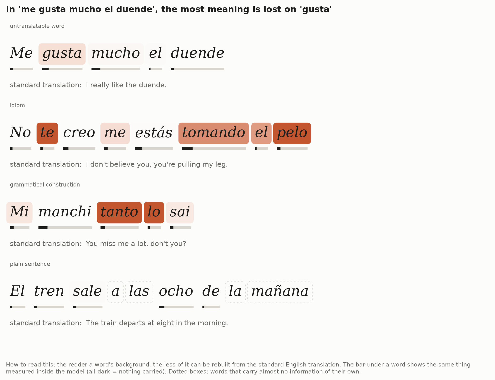  
How to read this: the redder a word's background, the less of it can be rebuilt from the standard English translation. The bar under a word shows the same thing measured inside the model (all dark = nothing carried). Dotted boxes: words that carry almost no information of their own.

**How much English it takes before the meaning gets across**  
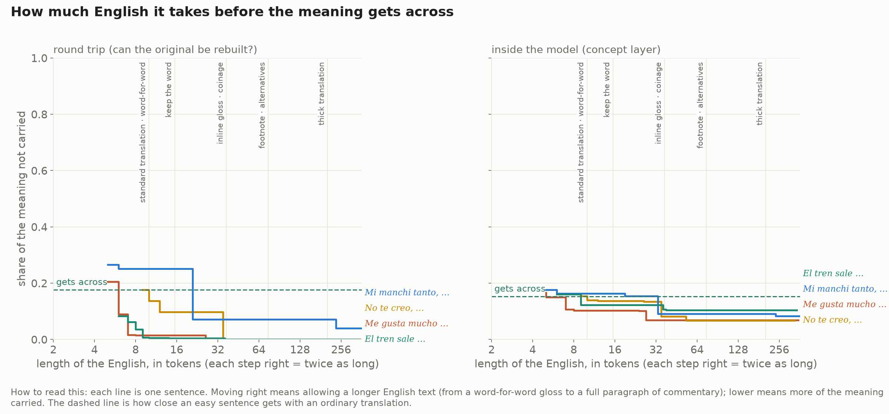  
How to read this: each line is one sentence. Moving right means allowing a longer English text (from a word-for-word gloss to a full paragraph of commentary); lower means more of the meaning carried. The dashed line is how close an easy sentence gets with an ordinary translation.

**Opening up a sentence instead of substituting word for word**  
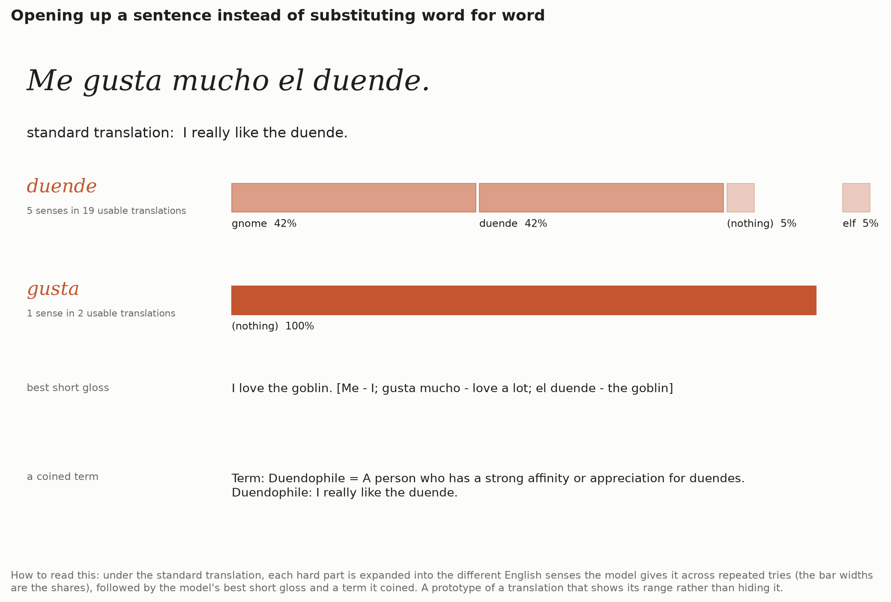  
How to read this: under the standard translation, each hard part is expanded into the different English senses the model gives it across repeated tries (the bar widths are the shares), followed by the model's best short gloss and a term it coined. A prototype of a translation that shows its range rather than hiding it.

**Glossing the marked words did not reliably beat glossing random words**  
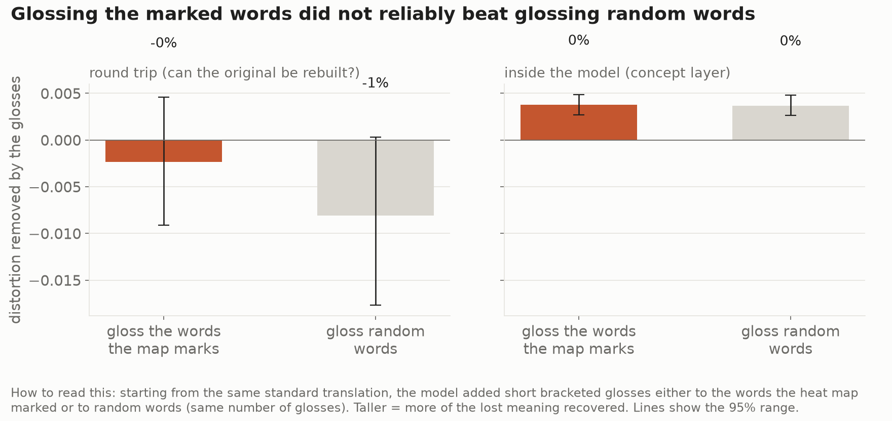  
How to read this: starting from the same standard translation, the model added short bracketed glosses either to the words the heat map marked or to random words (same number of glosses). Taller = more of the lost meaning recovered. Lines show the 95% range.

**Doublings of length needed, average by kind of sentence: plain 0.1, untranslatable word 0.5, construction 0.7, idiom 0.5, dialect 2.8**  
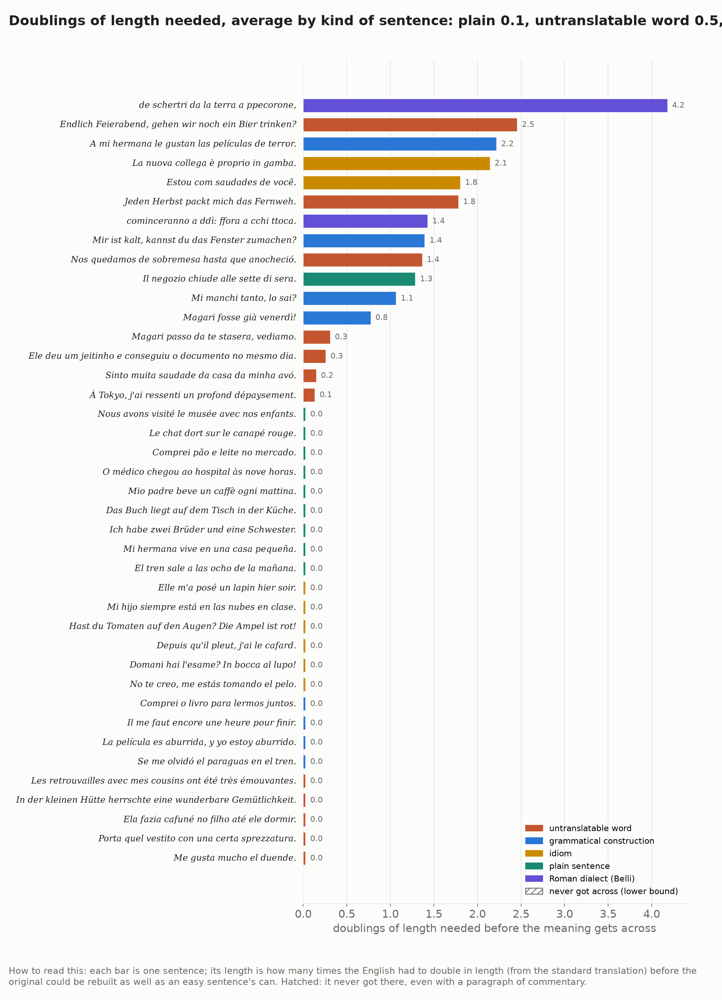  
How to read this: each bar is one sentence; its length is how many times the English had to double in length (from the standard translation) before the original could be rebuilt as well as an easy sentence's can. Hatched: it never got there, even with a paragraph of commentary.

**The two ways of measuring broadly agree (rank correlation 0.52)**  
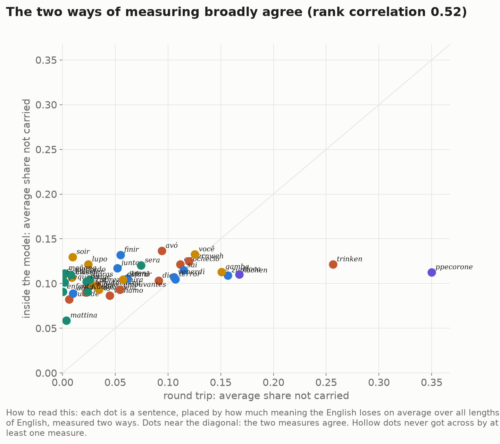  
How to read this: each dot is a sentence, placed by how much meaning the English loses on average over all lengths of English, measured two ways. Dots near the diagonal: the two measures agree. Hollow dots never got across by at least one measure.

